# MediBooking.in — Strategic Business Research Report

> **Prepared:** 1 November 2026  
> **Startup:** MediBooking.in  
> **Initial Market:** Bhopal, Madhya Pradesh, India  
> **Document Type:** Independent Research & Multi-Agent Strategic Analysis

---

## Table of Contents

1. [Executive Summary](#1-executive-summary)
2. [The Core Problem — Why This Matters](#2-the-core-problem)
3. [Market Landscape & Sizing](#3-market-landscape--sizing)
4. [Competitive Intelligence](#4-competitive-intelligence)
5. [Multi-Agent Strategic Analysis](#5-multi-agent-strategic-analysis)
6. [Bhopal — Local Market Deep Dive](#6-bhopal--local-market-deep-dive)
7. [Business Model Architecture](#7-business-model-architecture)
8. [Technology Architecture Vision](#8-technology-architecture-vision)
9. [Regulatory & Compliance Framework](#9-regulatory--compliance-framework)
10. [Financial Feasibility & Unit Economics](#10-financial-feasibility--unit-economics)
11. [Go-To-Market Playbook](#11-go-to-market-playbook)
12. [Risk Matrix & Mitigation](#12-risk-matrix--mitigation)
13. [90-Day Execution Roadmap](#13-90-day-execution-roadmap)
14. [Investor Readiness Assessment](#14-investor-readiness-assessment)
15. [Final Verdict & Recommendations](#15-final-verdict--recommendations)

---

## 1. Executive Summary

**MediBooking.in** is a proposed **clinic-first healthcare appointment management platform** targeting independent doctors and small clinics in India, starting from Bhopal, Madhya Pradesh.

### The Opportunity in One Line
> India has ~1.7M registered clinics, most running on phone calls, WhatsApp messages, and paper registers. MediBooking.in turns this chaos into a unified digital scheduling system that benefits doctors, receptionists, AND patients.

### Why Now?
- India's e-health market: **\$1.70B in 2025**, growing at **~22% CAGR**
- 800M+ internet users, UPI-native payments, WhatsApp as default communication
- Government pushing ABDM (Ayushman Bharat Digital Mission) adoption
- Post-pandemic normalization of digital health interactions
- Tier-2 cities like Bhopal are the **next frontier** — underserved by major platforms

### What MediBooking.in Is NOT
- ❌ Another Practo clone (doctor directory listing)
- ❌ A telemedicine platform (not initially)
- ❌ An EHR/EMR system (not initially)
- ❌ An AI diagnosis tool

### What MediBooking.in IS
- ✅ A **clinic operating system** (appointments, walk-ins, queue, staff)
- ✅ A **patient booking interface** (search, book, confirm, remind)
- ✅ A **unified scheduling engine** (online + phone + walk-in in one authoritative schedule)
- ✅ A **local-first marketplace** that grows organically from clinic operations

---

## 2. The Core Problem

### The Problem Ecosystem

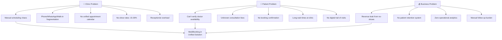

### Problem Validation Data

| Problem | Evidence | Severity |
|---------|----------|----------|
| Scheduling fragmentation | 70%+ clinics use manual registers + WhatsApp | 🔴 Critical |
| Patient no-shows | 15–30% OPD no-show rates nationally | 🔴 Critical |
| Fee transparency | Patients make 3–5 calls to compare fees | 🟡 High |
| Queue frustration | 45–60 min average wait at busy clinics | 🟡 High |
| Doctor discoverability | Tier-2 city doctors have minimal online presence | 🟡 High |
| Receptionist burden | 60%+ of receptionist time on phone coordination | 🟡 High |

### The Dual-Sided Problem Statement

> **For Patients:** Finding and booking a suitable doctor with trustworthy information and real-time availability is unreliable and frustrating.
>
> **For Clinics:** Managing online bookings, phone bookings, walk-ins, cancellations, queues, and staff responsibilities without unnecessary complexity is unsolved at the small-clinic level.

These problems are **interdependent** — a patient booking system is useless if the clinic schedule it reads from is inaccurate.

---

## 3. Market Landscape & Sizing

### India E-Health Market Overview

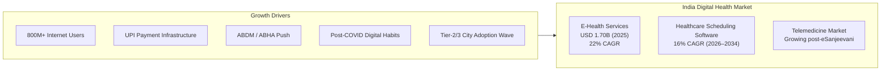

### Bottom-Up Market Sizing for MediBooking.in

| Parameter | Conservative | Moderate | Aggressive |
|-----------|-------------|----------|------------|
| Addressable clinics in Bhopal | 2,000 | 3,500 | 5,000 |
| Conversion to platform (Y1) | 2% (40) | 4% (140) | 7% (350) |
| Paying clinics (Y1) | 25 | 100 | 250 |
| Avg. monthly price (INR) | 999 | 1,499 | 1,999 |
| Monthly Revenue (INR) | 24,975 | 1,49,900 | 4,99,750 |
| **Annualized Revenue (INR)** | **2,99,700** | **17,98,800** | **59,97,000** |

### TAM → SAM → SOM Funnel

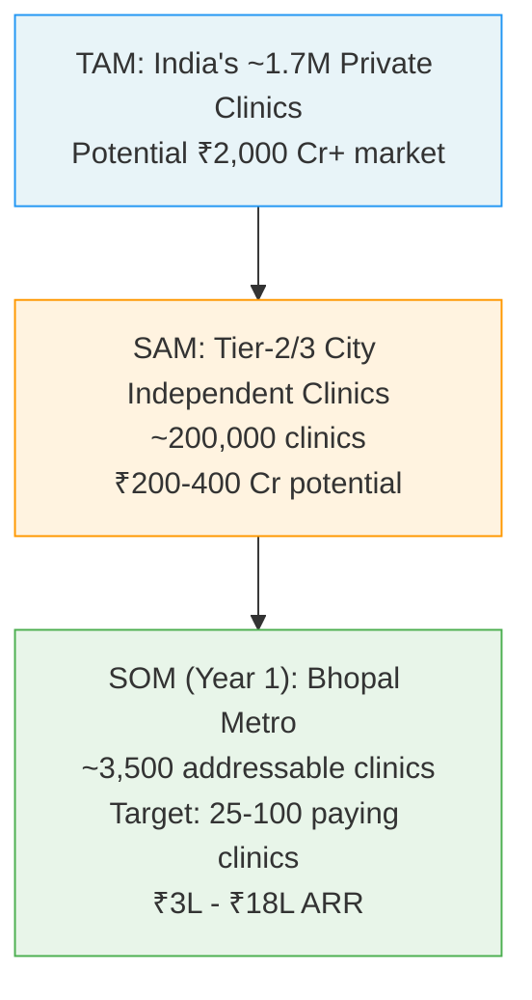

---

## 4. Competitive Intelligence

### Competitive Landscape Map

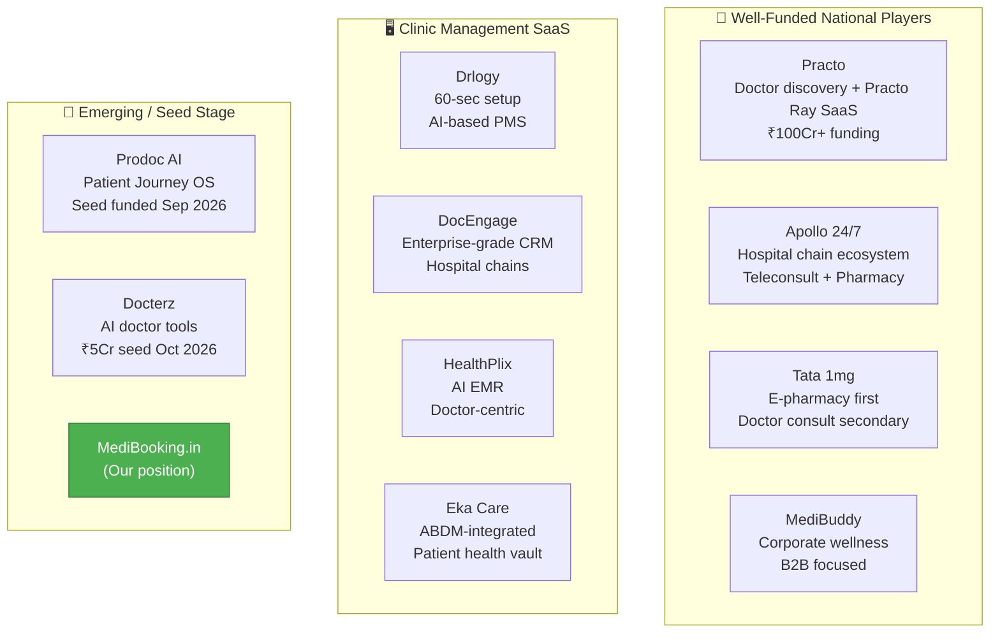

### Competitive Feature Matrix

| Feature | Practo | Drlogy | DocEngage | HealthPlix | **MediBooking.in** |
|---------|--------|--------|-----------|------------|-------------------|
| Doctor Discovery | ✅ | ❌ | ❌ | ❌ | ✅ |
| Online Appointment Booking | ✅ | ✅ | ✅ | ❌ | ✅ |
| Walk-in + Phone Unification | ❌ | Partial | ✅ | ❌ | ✅ (Core) |
| Receptionist Dashboard | Basic | ✅ | ✅ | ❌ | ✅ (Core) |
| Queue Management | ❌ | ✅ | ✅ | ❌ | ✅ |
| WhatsApp Integration | ❌ | ✅ | Partial | ❌ | ✅ (Planned) |
| Hindi Language Support | Partial | ❌ | ❌ | ❌ | ✅ (Day 1) |
| Tier-2 City Focus | Low | Medium | Low | Medium | ✅ (Core) |
| Starting Price | ₹5,000+/mo | ₹2,000+/mo | ₹3,000+/mo | ₹2,500+/mo | **₹999/mo** |
| Local On-Ground Support | ❌ | ❌ | ❌ | ❌ | ✅ (Founder-led) |

### MediBooking.in's Competitive Moats

| Moat Type | Strategy |
|-----------|----------|
| **Local Density** | Hyper-focus on Bhopal → own the city before expanding |
| **Price Point** | ₹999/mo undercuts all major competitors |
| **Unified Scheduling** | Online + Walk-in + Phone in one authoritative system |
| **Hindi-First UX** | Most competitors are English-only |
| **On-Ground Relationships** | Founder-led onboarding creates trust national players can't match |
| **Receptionist as Primary User** | Most platforms treat receptionists as secondary |

---

## 5. Multi-Agent Strategic Analysis

### Agent Framework Overview

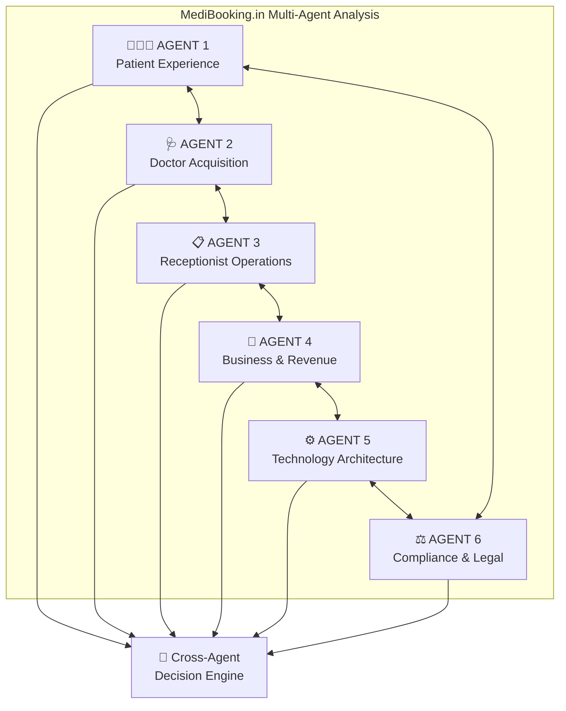

---

### 🧑‍🤝‍🧑 AGENT 1: Patient Experience Analysis

**Core Question:** *Why should a patient use MediBooking.in instead of calling the clinic?*

#### Patient Personas for Bhopal

| Persona | Profile | Primary Need | MediBooking.in Response |
|---------|---------|-------------|------------------------|
| **Ramesh** (Urban Professional) | IT professional in MP Nagar, age 32 | Book dermatologist after 6 PM without calling | Evening slot visibility, instant confirmation |
| **Sunita** (Family Caregiver) | Homemaker in Arera Colony, books for parents | Book ortho appointment for elderly father | Caregiver booking, Hindi UI, clear location info |
| **Ashok** (Small Town Traveler) | Govt employee from Raisen, needs specialist | Confirm slot before 2-hour travel | Confirmed booking + reminder before travel |

#### Patient Journey Map

```mermaid
flowchart LR
    A["Open MediBooking.in"] --> B["Search: Specialty + Location"]
    B --> C["Filter: Fee, Language, Time"]
    C --> D["View Verified Doctor Profile"]
    D --> E["Select Available Slot"]
    E --> F["Enter Patient Details"]
    F --> G["Pay Online or Choose Clinic Payment"]
    G --> H["Receive WhatsApp Confirmation"]
    H --> I["24hr Reminder via WhatsApp"]
    I --> J["Arrive at Clinic"]
    J --> K["Digital Check-in"]
    K --> L["Consultation"]
    L --> M["Follow-up Reminder (if needed)"]

    style A fill:#E3F2FD
    style H fill:#C8E6C9
    style M fill:#FFF9C4
```

#### Patient Acquisition Channels (Prioritized)

1. **Clinic-Driven (FREE):** QR codes at reception, booking links shared by clinics
2. **Local SEO:** "Best dermatologist in MP Nagar Bhopal" → MediBooking.in profile
3. **WhatsApp Forwarding:** Patients share booking links with family
4. **Google Business Profile Integration:** Direct booking from Google Maps
5. **Community Outreach:** Local events, employer partnerships

#### Patient Agent Verdict
> **✅ VIABLE** — Patient value proposition is strong IF clinic availability data is accurate. Without accurate schedules, the patient proposition collapses. Patient acquisition should be clinic-driven (near-zero CAC) rather than paid advertising.

---

### 🩺 AGENT 2: Doctor Acquisition & Retention Analysis

**Core Question:** *Why should a doctor pay ₹999/month for MediBooking.in when they already have patients?*

#### Doctor Value Proposition Matrix

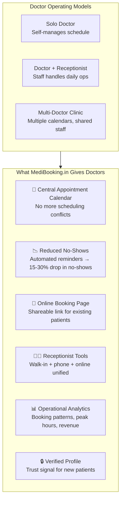

#### Three Doctor Operating Models & Pricing

| Model | Target | Price Point | Key Features |
|-------|--------|-------------|--------------|
| **Solo Basic** | Independent doctor, no staff | ₹999/mo | Profile, calendar, booking page, reminders |
| **Clinic Standard** | Doctor + receptionist | ₹1,499/mo | + Receptionist dashboard, walk-in management, queue |
| **Multi-Doctor** | 2–5 doctor clinic | ₹2,499/mo | + Multiple calendars, staff management, reporting |

#### Doctor Acquisition Funnel

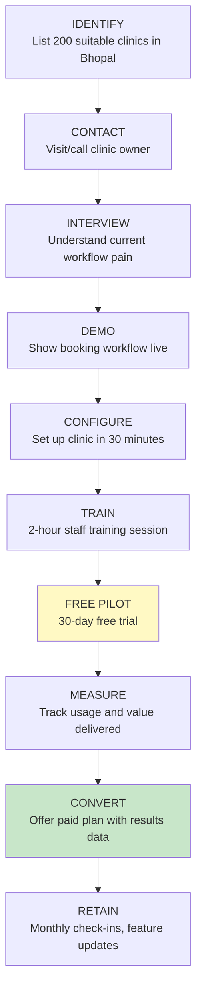

#### Doctor Retention KPIs

| Metric | Target (90 days) |
|--------|-----------------|
| Active clinics using system weekly | 80%+ of onboarded |
| Appointments managed per clinic per week | 20+ |
| Booking completion rate | 85%+ |
| 30-day retention | 90%+ |
| 90-day paid conversion | 40%+ |
| Doctor-initiated cancellation of service | < 10% |

#### Doctor Agent Verdict
> **✅ VIABLE** — The strongest proposition is **operational software** (scheduling + receptionist tools), NOT patient acquisition. A clinic that receives scheduling value will adopt BEFORE MediBooking.in has built a large patient marketplace. **Critical risk:** clinics may not perceive enough value to keep paying after free trial.

---

### 📋 AGENT 3: Receptionist & Operations Analysis

**Core Question:** *Will the receptionist actually use this, or will it create MORE work?*

> ⚠️ **This is the make-or-break agent.** If the receptionist doesn't adopt the system, the clinic won't use it, the schedule will be inaccurate, and patients will get wrong confirmations. The entire business collapses.

#### Receptionist Dashboard Requirements

| Feature | Required Behavior | Priority |
|---------|-------------------|----------|
| Today's Appointments | Show all confirmed appointments with status | 🔴 Must |
| Walk-in Registration | 1-click patient registration | 🔴 Must |
| Phone Booking Entry | Record telephone appointments in same schedule | 🔴 Must |
| Patient Check-in | Mark arrival, update queue position | 🔴 Must |
| Queue Management | Track: Waiting → In-Consultation → Completed | 🔴 Must |
| Schedule Changes | Reschedule with automatic patient notification | 🔴 Must |
| Doctor Availability | Show current slots, authorized schedule updates | 🟡 High |
| Payment Status | Record payment without exposing clinical data | 🟡 High |
| Daily Summary Report | Bookings, attendance, cancellations, no-shows | 🟡 High |

#### Appointment State Machine

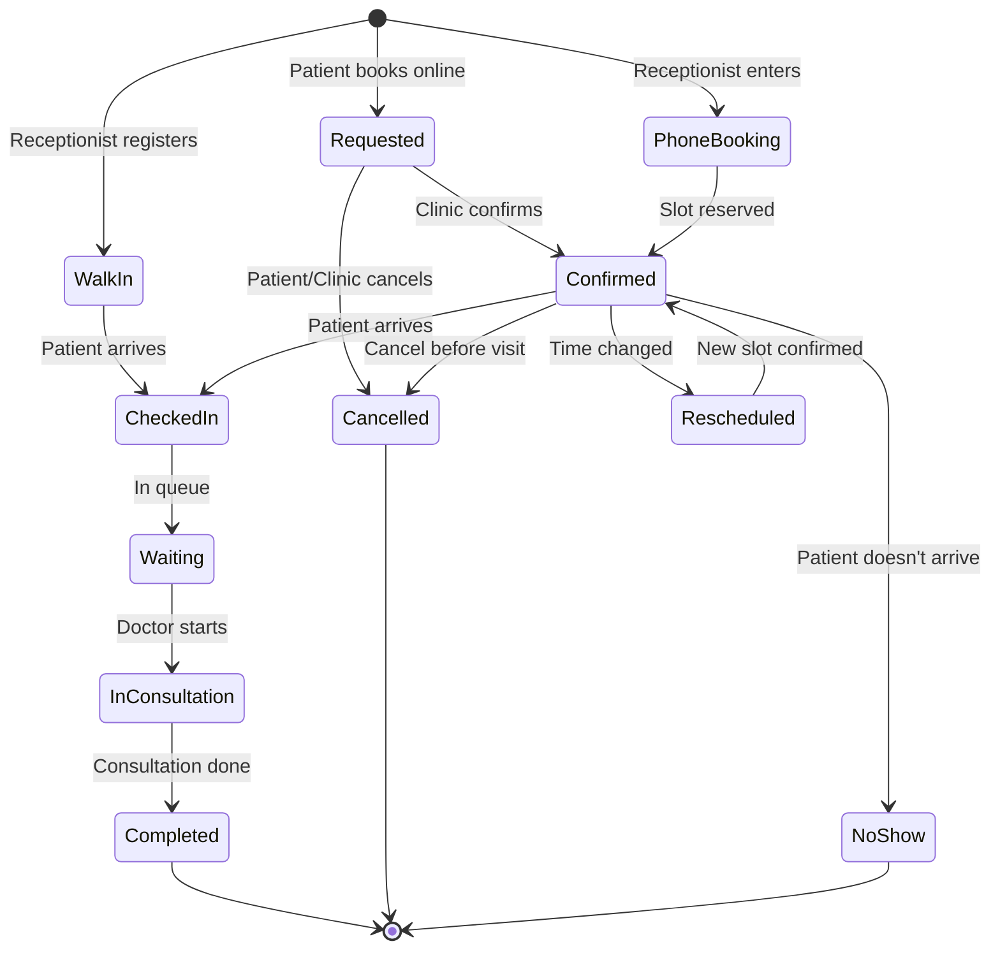

#### Unified Booking Principle

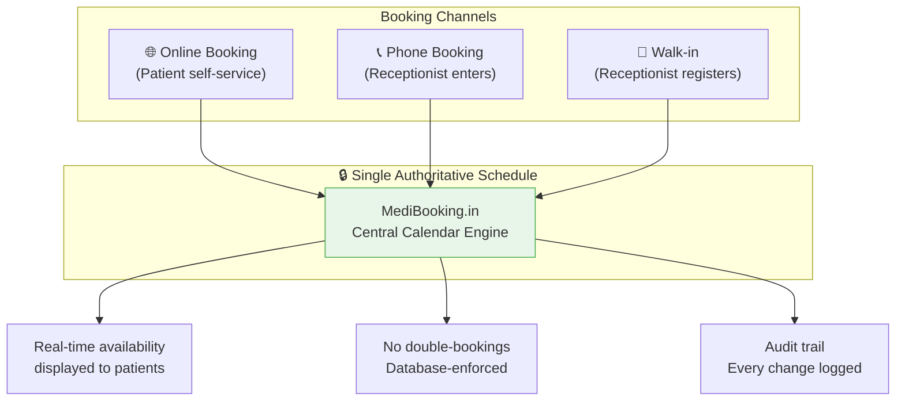

#### Role-Based Access Control

| Action | Doctor | Receptionist | Patient |
|--------|--------|-------------|---------|
| Manage availability | ✅ | Only if authorized | ❌ |
| Create appointments | ✅ | ✅ | ✅ (online only) |
| Reschedule bookings | ✅ | ✅ (within scope) | Own bookings only |
| Manage queue | ✅ | ✅ | View own position |
| View clinical notes | ✅ | ❌ | ❌ |
| View analytics | ✅ | Basic daily reports | ❌ |
| Manage clinic staff | ✅ (owner) | ❌ | ❌ |

#### Receptionist Agent Verdict
> **✅ VIABLE but CRITICAL** — The receptionist must be treated as the **primary operational user**. If the system creates parallel administrative work (maintain software AND manual register), it will be abandoned. The scheduling system must REPLACE fragmented workflows, not add another layer.

---

### 💼 AGENT 4: Business Model & Revenue Analysis

**Core Question:** *Can MediBooking.in acquire and retain customers economically?*

#### Recommended Business Model: Clinic-First Hybrid

```mermaid
flowchart LR
    subgraph Phase1["Phase 1: Clinic Software"]
        P1A["Onboard clinics"]
        P1B["Provide scheduling tools"]
        P1C["Create booking pages"]
        P1D["Clinics share with existing patients"]
    end

    subgraph Phase2["Phase 2: Local Marketplace"]
        P2A["SEO-driven patient discovery"]
        P2B["Verified doctor profiles"]
        P2C["Cross-clinic patient flow"]
    end

    subgraph Phase3["Phase 3: Connected Health"]
        P3A["Teleconsultation"]
        P3B["Diagnostics partnerships"]
        P3C["Patient health vault"]
    end

    Phase1 --> Phase2 --> Phase3
```

#### Revenue Streams (Phased)

| Stream | Phase | Revenue Type | Est. Contribution |
|--------|-------|-------------|-------------------|
| Clinic SaaS Subscriptions | 1 | Recurring (MRR) | 60-70% |
| Premium Tools (multi-location, analytics) | 2 | Recurring (MRR) | 15-20% |
| Sponsored Doctor Profiles | 2 | Transaction | 5-10% |
| Diagnostic Booking Commissions | 3 | Transaction | 5-10% |
| Teleconsultation Infrastructure Fee | 3 | Transaction | 5-10% |
| Enterprise/Corporate Health Bookings | 3+ | Contract | Future |

#### Revenue Model Comparison

| Model | Pros | Cons | MediBooking.in Choice |
|-------|------|------|----------------------|
| Free listing | Easy onboarding | No revenue | Use for initial 30-day trial |
| Monthly SaaS | Predictable MRR | Requires proven value | ✅ **Primary model** |
| Per-booking fee | Activity-aligned | Encourages off-platform booking | ❌ Avoid initially |
| Hybrid (free listing + paid tools) | Low friction entry | Complex pricing | ✅ Growth strategy |

#### Business Agent Verdict
> **✅ VIABLE** — A pure consumer marketplace would face crushing competition from Practo/Apollo. The **clinic-first SaaS** model provides predictable revenue, lower CAC, and natural patient acquisition through clinic distribution. **Key risk:** clinics may resist paying after free trial if perceived value is insufficient.

---

### ⚙️ AGENT 5: Technology Architecture Analysis

**Core Question:** *Can the system deliver dependable, correct booking services at low cost?*

#### Recommended Architecture

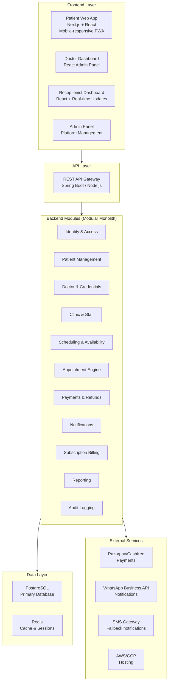

#### Technology Stack Recommendation

| Layer | Technology | Rationale |
|-------|-----------|-----------|
| Frontend | Next.js + React | SSR for SEO, mobile-responsive, PWA capable |
| Backend | Spring Boot (Java) OR Node.js (Express/NestJS) | Team skill dependent; both viable |
| Database | PostgreSQL | ACID compliance for booking correctness, free tier available |
| Cache | Redis | Session management, slot availability caching |
| Payments | Razorpay / Cashfree | Indian payment gateway, UPI support |
| Notifications | WhatsApp Business API + SMS | WhatsApp is India's #1 communication channel |
| Hosting | AWS / GCP / Railway | Start with managed services, scale later |
| Monitoring | Sentry + Grafana | Error tracking + operational metrics |
| AI (Future) | Gemini API / GPT | Natural language booking assistant |

#### Core Data Model

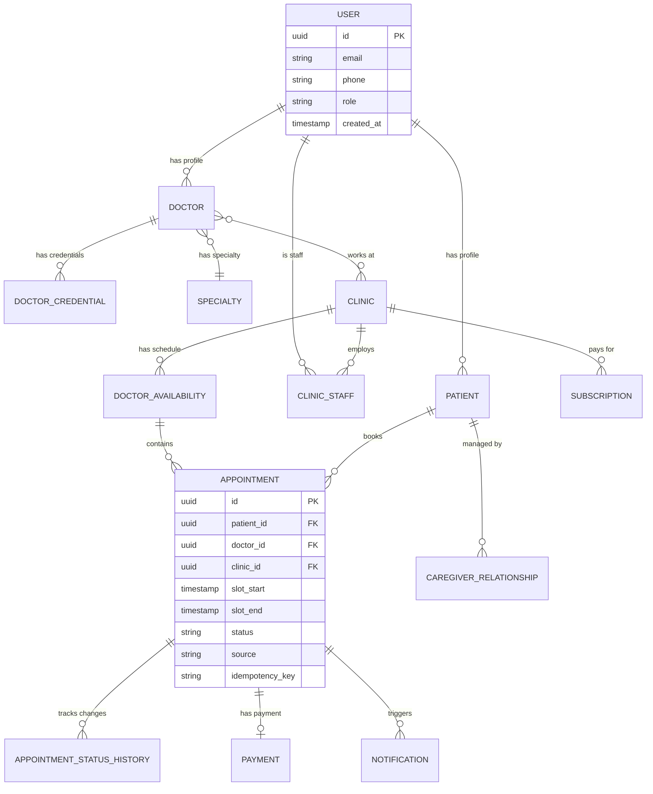

#### Booking Correctness — Critical Engineering

The most important technical requirement is **concurrent booking safety**:

```
1. Patient A and Patient B both see 5:00 PM slot as available
2. Both click "Book" within seconds
3. ONLY ONE booking must succeed
4. The other must receive a clear "slot taken" response
5. No phantom confirmed appointments
```

**Solution:** Database-level row locking + unique constraints + idempotency keys.

#### Technology Agent Verdict
> **✅ FEASIBLE** — The MVP is technically straightforward using conventional web stack. **Priority order:** (1) Booking correctness, (2) Access control, (3) Notification reliability, (4) Simple clinic workflows. AI features should wait until the core system is proven reliable.

---

### ⚖️ AGENT 6: Compliance & Legal Analysis

**Core Question:** *Can MediBooking.in operate responsibly under Indian healthcare and data protection laws?*

#### Regulatory Landscape

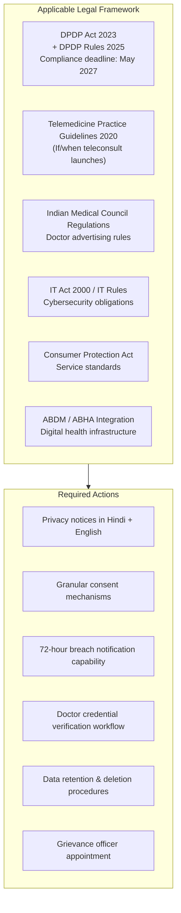

#### DPDP Compliance Checklist for MediBooking.in

| Requirement | Status | Action Needed |
|-------------|--------|---------------|
| Privacy notice at data collection | 🔴 Not started | Draft bilingual privacy notice |
| Granular consent (not bundled) | 🔴 Not started | Design consent UI flows |
| Data mapping (all touchpoints) | 🔴 Not started | Map every data collection point |
| Data Processing Agreements with vendors | 🔴 Not started | Template DPAs for cloud/SMS/payment vendors |
| Right to access/correction/erasure | 🔴 Not started | Build patient data portal |
| Breach notification (72 hours) | 🔴 Not started | Incident response plan |
| Grievance redressal mechanism | 🔴 Not started | Appoint officer, publish contact |
| Minor/guardian consent | 🔴 Not started | If serving patients < 18 |

#### Doctor Credential Verification

| Check | Source | Priority |
|-------|--------|----------|
| Identity verification | Government ID | 🔴 Must |
| Medical registration number | State Medical Council | 🔴 Must |
| Registration status (active) | ABDM Healthcare Professionals Registry | 🔴 Must |
| Specialty claims | Council certificate | 🟡 High |
| Clinic address verification | Physical visit during onboarding | 🟡 High |

#### Compliance Agent Verdict
> **✅ MANAGEABLE** — For the initial MVP (appointment booking only, no teleconsult, no clinical records), compliance is achievable. **Telemedicine and medical records must be postponed** until full legal review is completed. DPDP compliance should be designed in from Day 1, not retrofitted.

---

### 🎯 Cross-Agent Conflict Resolution

| Decision Point | Patient Interest | Doctor Interest | Resolution |
|---------------|-----------------|-----------------|------------|
| Advance payment | Prefers paying at clinic | Wants no-show protection | Optional advance via UPI; clear cancellation policy |
| Booking fees | Wants free booking | Wants committed patients | Free booking; doctors pay SaaS subscription |
| Real-time availability | Expects accurate slots | Needs walk-in flexibility | One authoritative schedule; walk-ins update immediately |
| AI assistance | Wants fast booking | Wants clinical control | AI for search/booking only; no diagnosis |
| Data access | Wants privacy | Receptionist needs operational data | Role-based access; least privilege |
| Sponsored listings | Wants trustworthy results | May want more visibility | Clearly labeled; no fake quality claims |

---

## 6. Bhopal — Local Market Deep Dive

### Why Bhopal?

| Factor | Assessment |
|--------|-----------|
| **Population** | ~25 lakh metro area; large enough for viable market |
| **Medical infrastructure** | AIIMS Bhopal, Bansal Hospital, Chirayu Medical College + thousands of independent clinics |
| **Underserved by platforms** | Major platforms (Practo, 1mg) have minimal Bhopal presence for small clinics |
| **Digital readiness** | High smartphone penetration, 4G/5G available, UPI widely adopted |
| **Founder access** | Founder-led relationships enable on-ground onboarding |
| **Language** | Hindi-first market; English-only tools face adoption barrier |
| **Referral hub** | Patients from Raisen, Vidisha, Sehore, Hoshangabad travel to Bhopal for specialists |

### Bhopal Clinic Geography

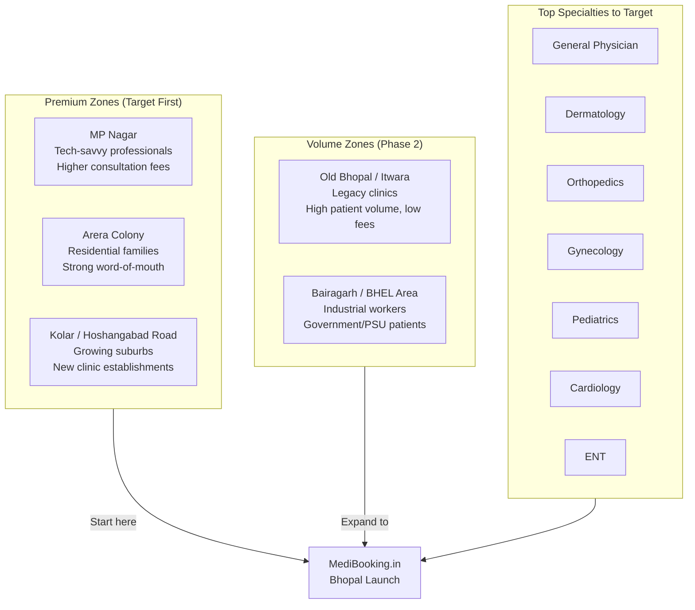

### Bhopal Market Characteristics

| Aspect | Data Point | Implication for MediBooking.in |
|--------|-----------|-------------------------------|
| Consultation fees | ₹200–800 (specialists: ₹500–1,500) | SaaS price must feel small vs. daily revenue |
| Digital marketing | Clinics use Google Business Profile + JustDial | Opportunity to be the next-gen digital presence |
| Patient behavior | WhatsApp-first communication | WhatsApp integration is mandatory, not optional |
| Competition | No dominant local scheduling platform | First-mover advantage in clinic SaaS |
| Language | Hindi dominant, English secondary | Hindi-first UI is a competitive moat |
| Referral patterns | Patients from 5+ surrounding districts | "Confirmed before travel" is high-value feature |

---

## 7. Business Model Architecture

### Revenue Model Flywheel

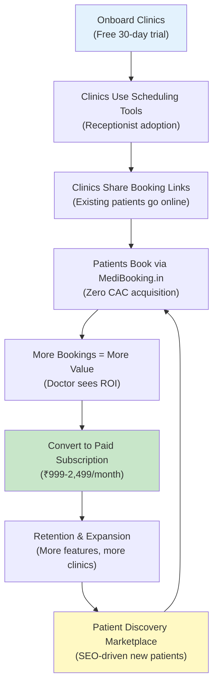

### Pricing Tiers (Proposed)

| Tier | Price | Target | Features |
|------|-------|--------|----------|
| **Free Trial** | ₹0 (30 days) | All new clinics | Full features, trial period |
| **Basic** | ₹999/mo | Solo doctor | Profile, calendar, booking page, 100 SMS/WhatsApp |
| **Standard** | ₹1,499/mo | Doctor + receptionist | + Receptionist dashboard, walk-in mgmt, queue, 300 notifications |
| **Professional** | ₹2,499/mo | Multi-doctor clinic | + Multiple calendars, staff mgmt, analytics, 1000 notifications |
| **Enterprise** | Custom | Hospital chain | Custom deployment, API access, dedicated support |

---

## 8. Technology Architecture Vision

### System Architecture (Detailed)

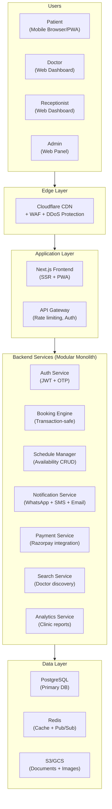

### MVP Feature Priority Matrix

| Feature | Priority | Sprint | Complexity |
|---------|----------|--------|------------|
| Doctor/Clinic profile CRUD | 🔴 Must | 1-2 | Low |
| Availability management | 🔴 Must | 2-3 | Medium |
| Online appointment booking | 🔴 Must | 3-4 | High |
| Receptionist walk-in/phone entry | 🔴 Must | 3-4 | Medium |
| WhatsApp confirmation notifications | 🔴 Must | 4-5 | Medium |
| Patient check-in + queue | 🟡 High | 5-6 | Medium |
| Cancellation + rescheduling | 🔴 Must | 5-6 | Medium |
| Payment integration | 🟡 High | 6-7 | Medium |
| Subscription billing | 🟡 High | 7-8 | Medium |
| Doctor search + discovery | 🟡 High | 7-8 | Medium |
| Analytics dashboard | 🟢 Nice | 8-9 | Low |
| AI booking assistant | 🔵 Future | Post-MVP | High |
| Teleconsultation | 🔵 Future | Post-MVP | Very High |

---

## 9. Regulatory & Compliance Framework

### Compliance Roadmap

```mermaid
flowchart LR
    subgraph PreLaunch["Pre-Launch (Days 1-30)"]
        PL1["Draft Privacy Policy<br/>(Hindi + English)"]
        PL2["Design Consent Flows"]
        PL3["Doctor Verification Process"]
        PL4["Terms of Service"]
    end

    subgraph Launch["Launch (Days 31-60)"]
        L1["Implement RBAC"]
        L2["Audit Logging"]
        L3["Encryption (transit + rest)"]
        L4["Grievance Officer Published"]
    end

    subgraph PostLaunch["Post-Launch (Days 61-90+)"]
        PO1["Breach Notification Plan"]
        PO2["Data Retention Policy"]
        PO3["Vendor DPAs"]
        PO4["Legal Review for Expansion"]
    end

    PreLaunch --> Launch --> PostLaunch
```

---

## 10. Financial Feasibility & Unit Economics

### Unit Economics Model (Per Clinic)

| Item | Monthly Amount (INR) |
|------|---------------------|
| Subscription revenue | 1,499 |
| (-) Payment gateway fees (~2%) | -30 |
| (-) WhatsApp/SMS costs (~₹0.50 × 200 notifications) | -100 |
| (-) Hosting/infra allocation | -50 |
| (-) Support time allocation (1hr × ₹200/hr) | -200 |
| **= Contribution per clinic** | **₹1,119** |
| **Contribution margin** | **~74.6%** |

### Customer Acquisition Cost (CAC) Analysis

| Activity | Cost per Clinic |
|----------|----------------|
| Founder's time (2 visits × 2 hours) | ₹1,000 (opportunity cost) |
| Demo + setup time | ₹500 |
| Training materials | ₹200 |
| Travel (within Bhopal) | ₹300 |
| **Total CAC** | **₹2,000** |

### Payback Period

$$\text{Payback} = \frac{\text{CAC}}{\text{Monthly Contribution}} = \frac{2{,}000}{1{,}119} \approx 1.8 \text{ months}$$

### Break-Even Analysis

Assuming monthly fixed costs of ₹1,50,000 (founder salary, hosting, tools, legal):

$$N_{\text{break-even}} = \left\lceil \frac{1{,}50{,}000}{1{,}119} \right\rceil = 135 \text{ paying clinics}$$

### 18-Month Financial Projection

| Month | Paying Clinics | MRR (INR) | Cumulative Revenue |
|-------|---------------|-----------|-------------------|
| 3 | 10 | 14,990 | 29,980 |
| 6 | 35 | 52,465 | 2,21,760 |
| 9 | 75 | 1,12,425 | 7,16,610 |
| 12 | 120 | 1,79,880 | 15,46,440 |
| 15 | 180 | 2,69,820 | 28,21,200 |
| 18 | 250 | 3,74,750 | 46,18,950 |

> **Note:** All projections are illustrative planning assumptions. Actual results depend on execution, market response, and churn rates.

---

## 11. Go-To-Market Playbook

### Phase 1: Bhopal City Domination (Months 1–6)

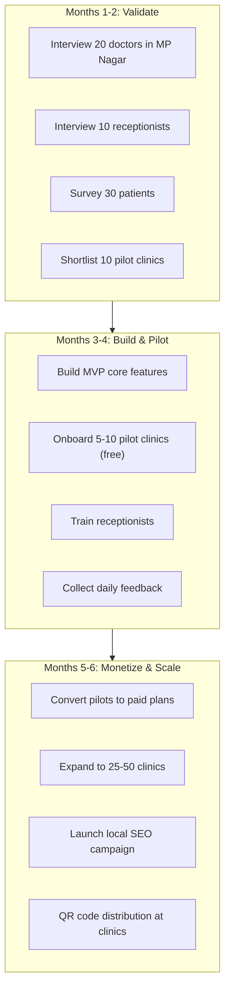

### Patient Acquisition: Clinic-Driven Strategy

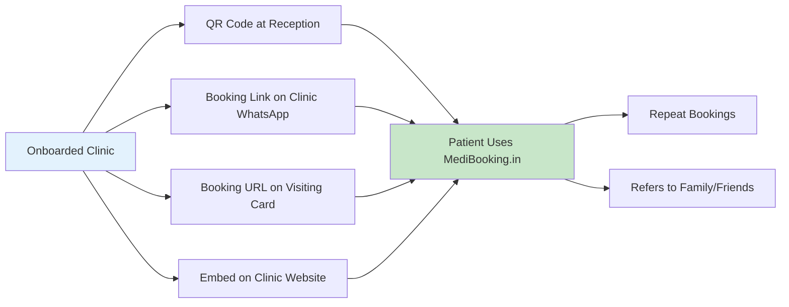

---

## 12. Risk Matrix & Mitigation

### Risk Heat Map

```mermaid
flowchart TD
    subgraph Critical["🔴 CRITICAL RISKS"]
        R1["Clinic doesn't adopt<br/>Mitigation: Free trial + on-ground training"]
        R2["Receptionist resistance<br/>Mitigation: Design for receptionist first"]
        R3["Inaccurate availability<br/>Mitigation: Unified booking engine"]
        R4["Double booking<br/>Mitigation: DB-level constraints"]
    end

    subgraph High["🟡 HIGH RISKS"]
        R5["Low willingness to pay<br/>Mitigation: Demonstrate value before asking"]
        R6["Competitor response<br/>Mitigation: Local density moat"]
        R7["High support costs<br/>Mitigation: Simplify onboarding"]
        R8["Data breach<br/>Mitigation: Security-first design"]
    end

    subgraph Medium["🟢 MODERATE RISKS"]
        R9["Overbuilding features<br/>Mitigation: Strict MVP discipline"]
        R10["Founder burnout<br/>Mitigation: Systematic process"]
        R11["Regulatory changes<br/>Mitigation: Legal review pipeline"]
    end
```

### Detailed Risk Register

| # | Risk | Probability | Impact | Mitigation | Owner |
|---|------|------------|--------|------------|-------|
| 1 | Insufficient clinic adoption | High | Critical | Paid pilots + interview validation | Founder |
| 2 | Receptionist doesn't use system | High | Critical | UX testing + hands-on training | Product |
| 3 | Inaccurate availability data | Medium | Critical | Unified schedule + backend enforcement | Engineering |
| 4 | Double/phantom bookings | Low | Critical | DB constraints + idempotency | Engineering |
| 5 | Clinics won't pay after trial | Medium | High | Demonstrate measurable value (no-show reduction, time saved) | Sales |
| 6 | Patient doesn't trust platform | Medium | High | Verified profiles + transparent fees | Product |
| 7 | Competitor copies features | Medium | Medium | Local density + relationships + speed | Strategy |
| 8 | Data breach | Low | Very High | Encryption + RBAC + audit + pen testing | Security |
| 9 | DPDP non-compliance | Medium | High | Privacy-by-design + legal review | Legal |
| 10 | High CAC | Medium | High | Clinic-driven patient acquisition (near-zero CAC) | Growth |

---

## 13. 90-Day Execution Roadmap

### Visual Roadmap

```mermaid
flowchart LR
    subgraph D1_15["Days 1-15<br/>VALIDATE"]
        V1["20 doctor interviews"]
        V2["10 receptionist interviews"]
        V3["30 patient surveys"]
        V4["Workflow mapping"]
        V5["Pilot clinic shortlist"]
    end

    subgraph D16_30["Days 16-30<br/>DESIGN"]
        DS1["User flow wireframes"]
        DS2["Appointment state machine"]
        DS3["RBAC design"]
        DS4["Privacy policy draft"]
        DS5["5-10 pilot commitments"]
    end

    subgraph D31_60["Days 31-60<br/>BUILD"]
        B1["Auth + profiles"]
        B2["Availability + booking"]
        B3["Receptionist dashboard"]
        B4["Patient booking UI"]
        B5["WhatsApp notifications"]
        B6["Cancellation + reschedule"]
    end

    subgraph D61_75["Days 61-75<br/>PILOT"]
        P1["Live with pilot clinics"]
        P2["Train receptionists"]
        P3["Daily error review"]
        P4["Patient feedback"]
        P5["Measure adoption"]
    end

    subgraph D76_90["Days 76-90<br/>VALIDATE REVENUE"]
        C1["Offer paid plans"]
        C2["Measure conversion"]
        C3["Calculate actual costs"]
        C4["Evaluate CAC"]
        C5["Go/No-Go decision"]
    end

    D1_15 --> D16_30 --> D31_60 --> D61_75 --> D76_90
```

### Day 90 Go/No-Go Criteria

| Criterion | Go Threshold | No-Go Signal |
|-----------|-------------|-------------|
| Pilot clinics onboarded | ≥ 5 active clinics | < 3 clinics interested |
| Receptionist daily usage | ≥ 80% of onboarded use weekly | < 50% weekly usage |
| Appointments managed | ≥ 20 per clinic per week | < 5 per clinic per week |
| Booking errors | < 2% error rate | > 5% error rate |
| Willingness to pay | ≥ 3 clinics convert to paid | 0 clinics willing to pay |
| Patient bookings | ≥ 10 patient-initiated per week per clinic | < 2 patient bookings |

---

## 14. Investor Readiness Assessment

### Funding Landscape Alignment (2025-2026)

| Investor Trend | MediBooking.in Alignment |
|---------------|-------------------------|
| B2B SaaS over consumer aggregators | ✅ Clinic-first SaaS model |
| AI-enhanced workflows | ✅ AI booking assistant roadmap |
| Unit economics focus | ✅ ~75% contribution margin, 1.8-month payback |
| Tier-2/3 city opportunity | ✅ Bhopal-first strategy |
| ABDM/ABHA integration | ✅ On roadmap |
| WhatsApp-first engagement | ✅ Core feature |

### Potential Funding Sources

| Source | Stage | Amount | Notes |
|--------|-------|--------|-------|
| Bootstrapped / Self-funded | Pre-seed | ₹5-10L | Current phase |
| Startup India Seed Fund | Seed | ₹20-50L | Government scheme |
| BIRAC (if health focus) | Seed | ₹30-50L | Zero-equity |
| MeitY Incubation | Pre-seed | Varies | Zero-equity programs |
| Angel investors | Seed | ₹25L-1Cr | Post-pilot validation |
| Micro-VC | Seed+ | ₹50L-3Cr | With 50+ paying clinics |

---

## 15. Final Verdict & Recommendations

### Multi-Agent Consensus

| Agent | Verdict | Confidence | Key Condition |
|-------|---------|------------|---------------|
| 🧑‍🤝‍🧑 Patient | ✅ Viable | High | IF clinic data is accurate |
| 🩺 Doctor | ✅ Viable | Medium | IF operational value is demonstrated |
| 📋 Receptionist | ✅ Viable (Critical) | Medium | IF system replaces (not adds to) workflow |
| 💼 Business | ✅ Viable | Medium | IF clinic-first model is executed well |
| ⚙️ Technology | ✅ Feasible | High | Standard web stack, booking correctness is key |
| ⚖️ Compliance | ✅ Manageable | High | Design privacy in from Day 1 |

### Top 10 Strategic Recommendations

1. **Validate before building** — Interview 20+ doctors and 10+ receptionists in Bhopal before writing code
2. **Receptionist is your most important user** — Design for them FIRST
3. **Build a unified scheduling engine** — Online + walk-in + phone in one authoritative system
4. **Start with responsive web, NOT a mobile app** — Patients don't need to install anything
5. **Hindi-first UI** — This is your competitive moat in Bhopal
6. **WhatsApp is your notification channel** — SMS is secondary
7. **Free trial → paid conversion** — Let clinics feel value before asking for money
8. **Booking correctness > features** — Zero double-bookings is more important than fancy analytics
9. **Compliance from Day 1** — DPDP Act privacy notices, consent flows, audit logging
10. **Don't build teleconsultation yet** — Adds massive regulatory complexity for minimal initial value

### The One-Sentence Business Hypothesis

> *Small clinics in Bhopal will pay ₹999-2,499/month for a system that reduces scheduling chaos, cuts no-shows, and gives patients a convenient way to book — IF the system works for the receptionist.*

**This hypothesis is plausible but unproven. The first 90 days must prove or disprove it.**

---

> **Document Version:** 1.0  
> **Last Updated:** 1 November 2026  
> **Next Review:** After Problem Validation Phase (Day 15)

---

*This document is a strategic planning resource. All financial projections are illustrative. Market data is sourced from public research. Legal requirements must be verified with qualified legal counsel before launch.*

