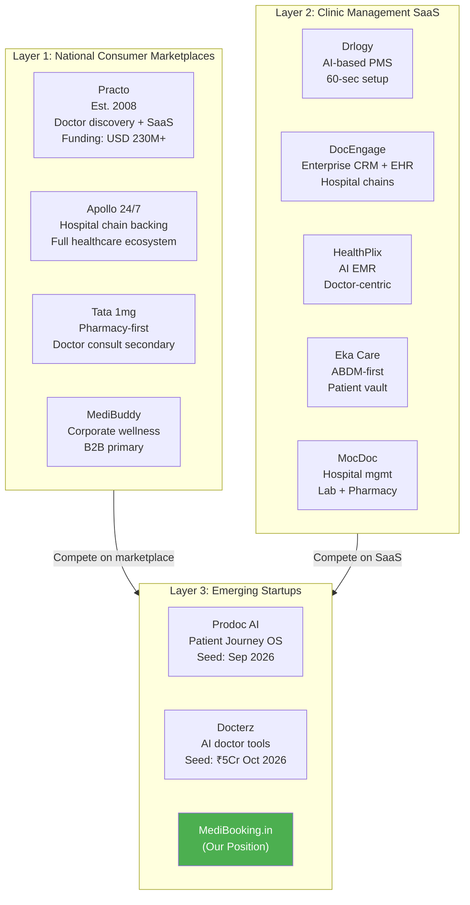
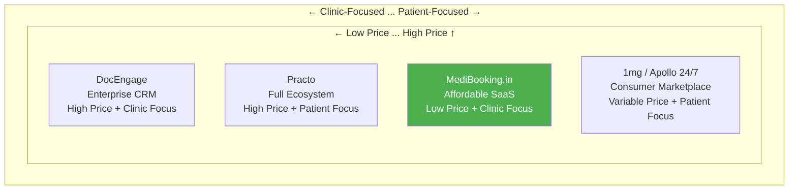
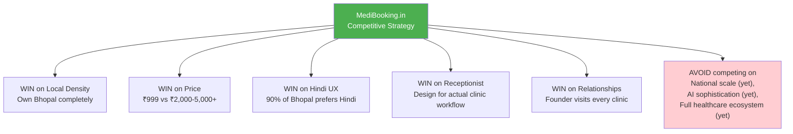

# MediBooking.in — Competitive Intelligence Report

> **Date:** 1 November 2026  
> **Focus:** India Healthcare Booking & Clinic SaaS Competitive Landscape

---

## 1. Competitive Ecosystem Overview

The Indian healthcare booking and clinic management space operates across three competitive layers:

---

## 2. Detailed Competitor Profiles

### 2.1 Practo — The Incumbent Giant

| Dimension | Details |
|-----------|---------|
| **Founded** | 2008, Bangalore |
| **Total Funding** | USD 230M+ |
| **Products** | Practo Ray (Clinic SaaS), Practo Search (Doctor Discovery), Practo Consult (Teleconsult) |
| **Revenue Model** | SaaS subscriptions (₹5,000+/mo), teleconsult commissions (15-25%), sponsored listings (Practo Prime) |
| **Strengths** | Network effects, brand recognition, 1L+ doctors listed, integrated ecosystem |
| **Weaknesses** | High pricing for small clinics, English-first, weak in Tier-2/3 cities, impersonal onboarding |
| **Threat to MediBooking.in** | HIGH — if they aggressively price down for Tier-2 market |
| **MediBooking.in Advantage** | Local presence, Hindi-first, ₹999 pricing, receptionist-centric design |

### Key Practo Strategy Insight
> Practo's B2B-first foundation (Practo Ray) is the anchor of its business. Consumer-facing acquisition has high CAC. MediBooking.in should learn from this: **B2B SaaS is the revenue backbone, consumer marketplace is the growth flywheel.**

### 2.2 Drlogy — The SaaS Competitor

| Dimension | Details |
|-----------|---------|
| **Focus** | Cloud + AI clinic management |
| **Pricing** | ₹2,000+/month |
| **Strengths** | Fast setup (60-sec claim), WhatsApp integration, multi-channel patient comms, AI features |
| **Weaknesses** | No local on-ground support, limited patient discovery, generic for all cities |
| **Threat to MediBooking.in** | MEDIUM — better product features but no local moat |

### 2.3 DocEngage — The Enterprise Player

| Dimension | Details |
|-----------|---------|
| **Focus** | Healthcare CRM + EHR for hospitals/chains |
| **Pricing** | ₹3,000+/month |
| **Strengths** | Advanced CRM, lifecycle tracking, marketing automation, multi-center management |
| **Weaknesses** | Too complex for solo doctors, enterprise-focused, high price point |
| **Threat to MediBooking.in** | LOW — different market segment |

### 2.4 HealthPlix

| Dimension | Details |
|-----------|---------|
| **Focus** | AI-powered EMR for doctors |
| **Pricing** | ₹2,500+/month |
| **Strengths** | Voice-to-text clinical notes, AI prescription generation, ABDM compliance |
| **Weaknesses** | No patient-facing marketplace, no receptionist focus, limited scheduling |
| **Threat to MediBooking.in** | LOW — complementary rather than competing |

### 2.5 Eka Care

| Dimension | Details |
|-----------|---------|
| **Focus** | Patient health vault + ABDM integration |
| **Strengths** | ABHA ID integration, patient-controlled records, government alignment |
| **Weaknesses** | Doctor SaaS features are secondary, limited scheduling |
| **Threat to MediBooking.in** | LOW — potential integration partner |

---

## 3. Competitive Positioning Matrix

### Where MediBooking.in Fits

**Quadrant: Low Price + Clinic Focus** — This is the least crowded quadrant. Most competitors are either:
- High price + clinic-focused (DocEngage, HealthPlix)
- High price + patient-focused (Practo, Apollo)
- Patient-focused marketplaces (1mg, MediBuddy)

**Nobody is doing affordable clinic-first SaaS with local on-ground support in Tier-2 cities.**

---

## 4. Competitive Differentiation Strategy

### MediBooking.in's 6 Competitive Moats

| # | Moat | Why It Works | How to Build It |
|---|------|-------------|----------------|
| 1 | **Local Density** | Network effects work at city level — 50 clinics in Bhopal > 500 scattered across India | Own Bhopal first, then replicate model |
| 2 | **Price Point** | ₹999/mo is 3-5x cheaper than competitors | Lean operations, founder-led sales |
| 3 | **Receptionist-First Design** | Competitors treat receptionists as secondary users | Design every screen for the receptionist workflow |
| 4 | **Hindi-First UX** | 90%+ of Bhopal clinic staff prefer Hindi | Bilingual from Day 1 |
| 5 | **On-Ground Relationships** | National players can't visit every Bhopal clinic | Founder-led onboarding and training |
| 6 | **Unified Scheduling** | Most competitors separate online vs. walk-in booking | One authoritative schedule across all channels |

---

## 5. Competitor Response Scenarios

| Scenario | Probability | Impact | MediBooking.in Response |
|----------|------------|--------|------------------------|
| Practo drops price to ₹999 for Tier-2 | Low (20%) | High | Already have local relationships + Hindi + receptionist features |
| Drlogy launches Bhopal-specific campaign | Medium (35%) | Medium | Deepen on-ground presence, highlight local support |
| New well-funded startup enters Bhopal | Low (15%) | Medium | Speed of execution + existing clinic base = switching cost |
| Google/JustDial adds scheduling | Medium (30%) | Low-Medium | Deeper workflow integration > simple scheduling widget |
| Hospital chains build own systems | High (60%) | Low | Not our target market (we focus on independent clinics) |

---

## 6. Lessons from Competitor Strategies

### What to LEARN from Practo
1. B2B SaaS subscription is the revenue backbone (Practo Ray)
2. Once clinic uses your software, marketplace integration is seamless
3. Network effects: more doctors → more patients → more doctors
4. Ecosystem lock-in through data (health vault, prescriptions)

### What to AVOID from Practo
1. Don't try to build everything at once (teleconsult + pharmacy + diagnostics)
2. Don't ignore Tier-2/3 city clinics
3. Don't price out small independent doctors
4. Don't make onboarding impersonal and remote-only

### What to LEARN from Drlogy
1. "60-second setup" messaging works for doctor acquisition
2. WhatsApp integration is table stakes in India
3. AI features (even basic ones) are strong marketing hooks

### What to LEARN from Recent Seed Rounds (Prodoc AI, Docterz)
1. Investors want AI-enhanced clinical workflows, not just scheduling
2. Doctor validation (doctors investing in the startup) is powerful signal
3. "Patient Journey OS" framing resonates with investors
4. ₹5Cr seed rounds are achievable with right metrics

---

## 7. Competitive Strategy Summary

---

*This competitive intelligence should be updated monthly as the market evolves rapidly.*

