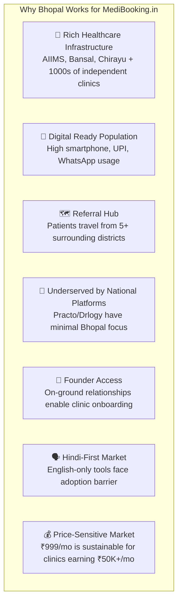
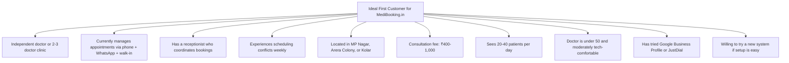
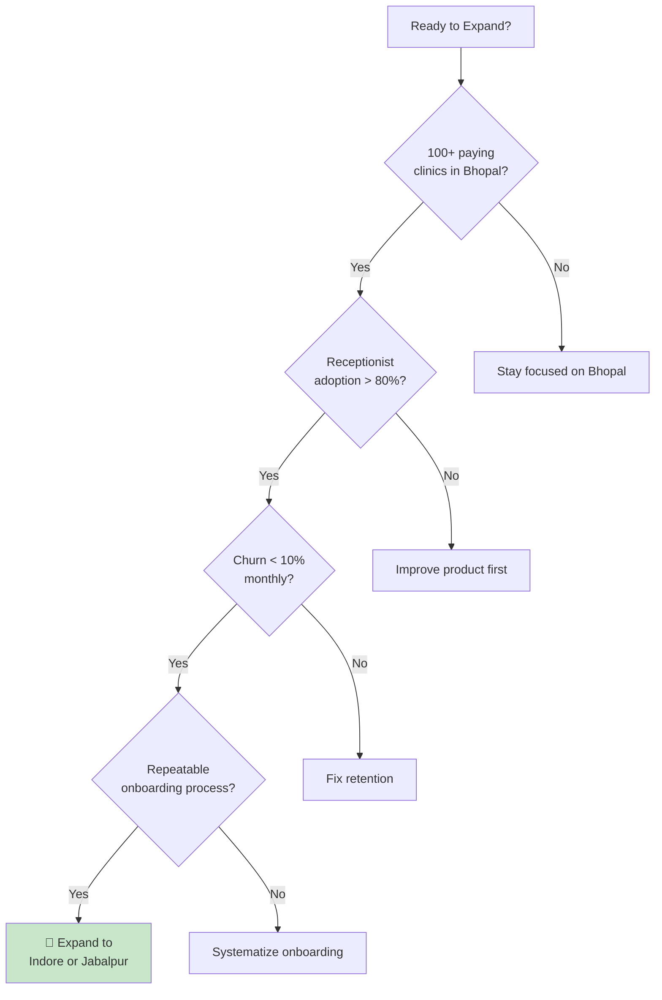

# MediBooking.in — Bhopal Market Research Report

> **Date:** 1 November 2026  
> **Focus:** Local Market Analysis for Bhopal, Madhya Pradesh

---

## 1. Why Bhopal as the Launch Market

### City Profile

| Parameter | Data |
|-----------|------|
| **Metro Population** | ~25 lakh (2.5 million) |
| **Status** | State Capital of Madhya Pradesh |
| **Tier Classification** | Tier-2 city |
| **GDP Growth** | Growing service economy, IT/ITES hubs emerging |
| **Digital Infrastructure** | 4G/5G coverage across city, high smartphone penetration |
| **Language** | Hindi dominant (~90%), English secondary |
| **UPI Adoption** | Very high — used daily by most working adults |
| **Medical Tourism** | Regional hub — patients from Raisen, Vidisha, Sehore, Hoshangabad, Betul |

### Strategic Advantages of Bhopal

---

## 2. Bhopal Clinic Landscape

### Geographic Segmentation

| Zone | Characteristics | Ideal for MediBooking.in? | Priority |
|------|----------------|--------------------------|----------|
| **MP Nagar** | Commercial hub, tech-savvy professionals, higher consultation fees (₹500-1,500) | ✅ Yes — high willingness to adopt digital tools | 🔴 Phase 1 |
| **Arera Colony** | Residential families, strong word-of-mouth networks, family doctors | ✅ Yes — family booking use case strong | 🔴 Phase 1 |
| **Kolar / Hoshangabad Road** | Growing suburbs, new clinic establishments, younger doctors | ✅ Yes — early adopters, building patient base | 🔴 Phase 1 |
| **Old Bhopal / Itwara** | Legacy clinics, high volume, lower fees (₹200-400) | ⚠️ Maybe — high volume but manual workflow resistance | 🟡 Phase 2 |
| **Bairagarh / BHEL** | Industrial workers, PSU employees, insurance patients | ⚠️ Maybe — corporate tie-ups could work | 🟡 Phase 2 |
| **Habibganj / New Market** | Mixed commercial/residential, moderate digital adoption | ✅ Yes — good balance of volume and digital readiness | 🟡 Phase 2 |

### Target Clinic Profile (Ideal First Customer)

---

## 3. Top Specialties to Target

Based on Bhopal patient search volume and clinic density:

| Specialty | Search Demand | Clinic Density | Digital Readiness | Priority |
|-----------|--------------|---------------|-------------------|----------|
| General Physician | Very High | Very High | Medium | 🔴 Must |
| Dermatology | High | High | High | 🔴 Must |
| Orthopedics | High | High | Medium | 🔴 Must |
| Gynecology / Obstetrics | High | High | Medium | 🔴 Must |
| Pediatrics | High | High | Medium | 🟡 High |
| Cardiology | Medium-High | Medium | High | 🟡 High |
| ENT | Medium | Medium | Medium | 🟡 High |
| Ophthalmology | Medium | Medium | Medium | 🟢 Good |
| Dental | High | Very High | High | 🟢 Good |
| Pulmonology | Medium | Low-Medium | High | 🟢 Good |

---

## 4. Patient Behavior in Bhopal

### How Bhopal Patients Currently Find Doctors

| Channel | Usage | Trend |
|---------|-------|-------|
| **Word of mouth / family referral** | ~50% | Stable — strongest channel |
| **Google Search / Maps** | ~25% | Rising — especially among younger adults |
| **JustDial / Sulekha** | ~10% | Declining — moving to Google |
| **Practo / 1mg** | ~5% | Low presence in Bhopal |
| **WhatsApp groups / social media** | ~7% | Rising — community health groups |
| **Walk-in (no prior booking)** | ~35% of visits | Stable — especially in high-volume areas |

### Key Patient Pain Points (Bhopal-Specific)

1. **"I called the clinic 3 times and no one picked up"** — Phone booking frustration
2. **"I traveled 2 hours from Raisen and the doctor was on leave"** — No real-time availability
3. **"I don't know if ₹500 or ₹800 is the consultation fee"** — Fee opacity
4. **"I waited 90 minutes past my appointment time"** — Queue management failure
5. **"My father needs an ortho appointment but can't use apps"** — Caregiver booking need

### Patient Communication Preferences

| Channel | Preference | Notes |
|---------|-----------|-------|
| **WhatsApp** | 85%+ | Default channel — booking confirmations, reminders, reschedule |
| **SMS** | 50% | Fallback — when WhatsApp undelivered |
| **Phone call** | 40% | For complex queries, elderly patients |
| **Email** | 10% | Very low — most patients don't check email regularly |
| **App notification** | 5% | Only if PWA is installed |

---

## 5. Competitive Presence in Bhopal

### Current Platform Penetration

| Platform | Bhopal Presence | Doctor Listings | Active Bookings |
|----------|----------------|-----------------|-----------------|
| Practo | Low-Medium | ~500-800 listed, few actively manage | Very low booking activity |
| JustDial | Medium | ~2,000+ listed | Mostly directory, no scheduling |
| Google Business | High | ~3,000+ profiles | No appointment management |
| Drlogy | Very Low | < 50 active | Minimal penetration |
| DocEngage | Very Low | < 20 (hospitals only) | Enterprise only |
| **MediBooking.in** | **Not yet launched** | **Target: 100+ in 6 months** | **Target: 1,000+ bookings/mo** |

### The Gap MediBooking.in Fills

```mermaid
flowchart LR
    subgraph Current["What Bhopal Clinics Have Now"]
        C1["Google Business Profile<br/>(Discovery only, no booking)"]
        C2["WhatsApp<br/>(Unstructured, chaotic)"]
        C3["Phone<br/>(Missed calls, busy lines)"]
        C4["Paper Register<br/>(No analytics, no backups)"]
    end

    subgraph Gap["THE GAP"]
        G1["No unified<br/>scheduling system"]
        G2["No online booking<br/>with real availability"]
        G3["No WhatsApp<br/>integration with calendar"]
        G4["No queue management<br/>for patients"]
    end

    subgraph Solution["MediBooking.in Solution"]
        S1["Unified Calendar<br/>(Online + Phone + Walk-in)"]
        S2["Patient Booking Page<br/>(Real availability)"]
        S3["WhatsApp Notifications<br/>(Auto confirmations)"]
        S4["Queue Dashboard<br/>(Receptionist view)"]
    end

    Current --> Gap --> Solution

    style Gap fill:#FFCDD2
    style Solution fill:#C8E6C9
```

---

## 6. Bhopal Market Entry Strategy

### Week-by-Week Plan (First 30 Days)

| Week | Activities | Target |
|------|-----------|--------|
| **Week 1** | Map clinics in MP Nagar + Arera Colony; create target list of 50 clinics | 50 clinics identified |
| **Week 2** | Visit 15-20 clinics; interview doctors and receptionists; document current workflows | 15+ interviews completed |
| **Week 3** | Visit remaining clinics; share product mockups; identify pilot candidates | 10+ pilot candidates |
| **Week 4** | Finalize 5-10 pilot commitments; begin training plan design | 5-10 signed pilot letters |

### Clinic Onboarding Script (Elevator Pitch)

> *"Doctor sahab, main [Name] hoon, MediBooking.in se. Hum Bhopal ke clinics ke liye ek simple online booking system bana rahe hain. Aapke patients phone pe slot book kar sakte hain, WhatsApp pe confirmation aata hai, aur aapki receptionist ek hi screen pe sab manage kar sakti hai — online booking, phone booking, walk-in sab ek jagah. Pehle 30 din free hai. Kya hum 10 minute mein aapko dikhaa sakte hain?"*

Translation: "Doctor, I'm [Name] from MediBooking.in. We're building a simple online booking system for Bhopal clinics. Your patients can book slots on phone, get WhatsApp confirmation, and your receptionist can manage everything on one screen — online, phone, walk-in all in one place. First 30 days free. Can we show you in 10 minutes?"

---

## 7. Bhopal Revenue Projections

### Conservative Model (Year 1)

| Quarter | Target Clinics | Paying Clinics | MRR (INR) | Notes |
|---------|---------------|----------------|-----------|-------|
| Q1 (Mo 1-3) | 10-15 onboarded | 5-8 paid | ₹7,500-12,000 | Pilot + first conversions |
| Q2 (Mo 4-6) | 30-40 onboarded | 20-25 paid | ₹25,000-37,500 | Word of mouth kicks in |
| Q3 (Mo 7-9) | 60-80 onboarded | 45-55 paid | ₹55,000-82,500 | SEO + referrals growing |
| Q4 (Mo 10-12) | 100-120 onboarded | 75-90 paid | ₹90,000-1,35,000 | Stable recurring base |

**Year 1 Total Revenue Estimate (Conservative): ₹5-8 Lakh**

### When to Expand Beyond Bhopal

---

*Bhopal market data should be refreshed after completing the problem validation phase (Days 1-15).*

