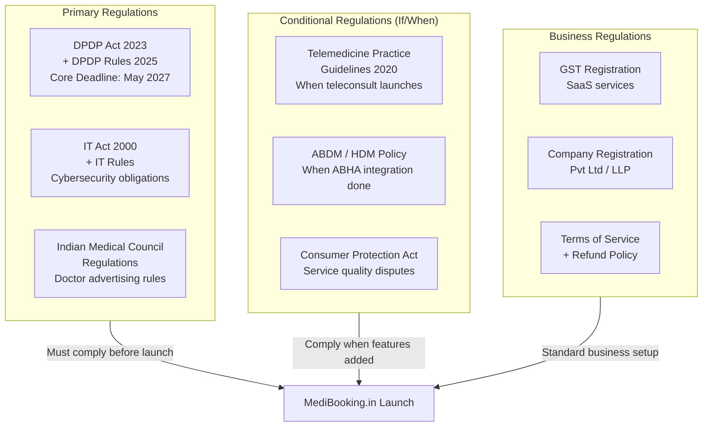
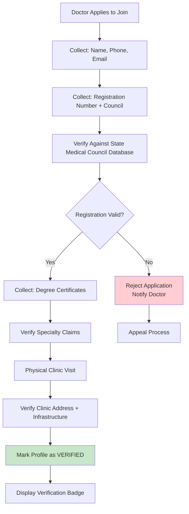

# MediBooking.in — Regulatory & Compliance Guide

> **Date:** 1 November 2026  
> **Focus:** Legal, Compliance, and Regulatory Requirements for Healthcare Booking Platform in India

---

## 1. Regulatory Framework Overview

---

## 2. DPDP Act 2023 Compliance

### What MediBooking.in Must Do

| Requirement | Description | Deadline | Priority |
|-------------|------------|----------|----------|
| **Privacy Notice** | Clear, bilingual (Hindi + English) notice explaining data collection, purpose, and usage | Before collecting any data | 🔴 Day 1 |
| **Consent Mechanism** | Explicit, granular consent (not bundled with ToS) | Before launch | 🔴 Day 1 |
| **Data Mapping** | Document every touchpoint where personal data enters system | Before launch | 🔴 Must |
| **Access Controls** | Role-based access to patient data (RBAC) | Before launch | 🔴 Must |
| **Data Minimization** | Collect only necessary data for appointment booking | Design phase | 🔴 Must |
| **Right to Access** | Patients can view their data | Within 3 months | 🟡 High |
| **Right to Correction** | Patients can request data corrections | Within 3 months | 🟡 High |
| **Right to Erasure** | Patients can request data deletion | Within 6 months | 🟡 High |
| **Breach Notification** | Report breaches to DPBI within 72 hours | Incident response plan ready | 🟡 High |
| **Vendor DPAs** | Data Processing Agreements with cloud/SMS/payment vendors | Before launch | 🟡 High |
| **Grievance Officer** | Publish contact details on platform | Before launch | 🔴 Must |
| **Retention Policy** | Define how long data is kept and when deleted | Before launch | 🟡 High |

### Penalty Framework

| Violation | Maximum Penalty |
|-----------|----------------|
| Non-compliance with DPDP Act provisions | Up to ₹250 Crore |
| Data breach due to negligence | Up to ₹250 Crore |
| Failure to notify breach | Up to ₹200 Crore |
| Non-compliance for children's data | Up to ₹200 Crore |

> ⚠️ **There are NO exemptions based on startup size or revenue.** MediBooking.in is a Data Fiduciary from Day 1.

---

## 3. Doctor Credential Verification

### Verification Workflow

### Verification Checklist

| Check | Source | Mandatory |
|-------|--------|-----------|
| Government ID (Aadhaar/PAN) | Doctor provides | ✅ Yes |
| Medical Registration Number | Doctor provides + State Council verification | ✅ Yes |
| Registration Status (Active) | ABDM Healthcare Professionals Registry | ✅ Yes |
| MBBS / BDS / Specialty Degree | Certificate copy | ✅ Yes |
| Specialty Claims | Council certificate | ✅ Yes |
| Clinic Address | Physical visit during onboarding | ✅ Yes |
| Clinic Photos | Taken during visit | 🟡 Recommended |

---

## 4. Security Controls

### Minimum Security Requirements

| Control | Implementation | Priority |
|---------|---------------|----------|
| **HTTPS/TLS** | All traffic encrypted in transit | 🔴 Must |
| **Database Encryption** | AES-256 encryption at rest for patient data | 🔴 Must |
| **Password Hashing** | bcrypt/argon2 — never store plaintext | 🔴 Must |
| **OTP Authentication** | SMS/WhatsApp OTP for login | 🔴 Must |
| **RBAC** | Role-based access control for all endpoints | 🔴 Must |
| **Audit Logging** | Log every data access and modification | 🔴 Must |
| **Rate Limiting** | Prevent brute force and abuse | 🔴 Must |
| **Input Validation** | Prevent SQL injection, XSS | 🔴 Must |
| **Secrets Management** | Use vault/env vars, never commit secrets | 🔴 Must |
| **Backups** | Automated daily backups with recovery testing | 🟡 High |
| **Vulnerability Scanning** | Regular dependency and infrastructure scans | 🟡 High |
| **Incident Response Plan** | Documented procedure for security incidents | 🟡 High |
| **Production Data Access** | Restricted; no patient data in dev/staging | 🟡 High |

---

## 5. When Telemedicine Is Added (Future)

### Telemedicine Practice Guidelines 2020 Requirements

| Requirement | Description |
|-------------|------------|
| Practitioner ID | Verified doctor identity for every teleconsult |
| Patient ID | Appropriate patient identification |
| Consent | Teleconsult-specific consent capture |
| Communication | Secure, encrypted audio/video channel |
| Documentation | Consultation notes must be maintained |
| Escalation | Clear pathway to in-person referral |
| Emergency | Must not handle emergencies via teleconsult — direct to ER |
| Prescription | Follow e-prescription guidelines |

> 🔵 **MediBooking.in should NOT launch teleconsultation features until all Telemedicine Practice Guidelines are reviewed with a healthcare lawyer.**

---

## 6. Compliance Timeline

```mermaid
flowchart LR
    subgraph PreDev["Pre-Development"]
        PD1["Company Registration"]
        PD2["GST Registration"]
        PD3["Privacy Policy Draft"]
        PD4["Terms of Service Draft"]
    end

    subgraph MVP["MVP Launch"]
        M1["Consent Flows Implemented"]
        M2["RBAC in Production"]
        M3["Audit Logging Active"]
        M4["Grievance Officer Published"]
        M5["Doctor Verification Active"]
    end

    subgraph Post["Post-Launch (90 days)"]
        P1["Patient Data Portal (Access/Delete)"]
        P2["Vendor DPAs Signed"]
        P3["Incident Response Tested"]
        P4["Security Audit"]
    end

    subgraph Future["Future (When Features Added)"]
        F1["Telemedicine Legal Review"]
        F2["ABDM Integration Compliance"]
        F3["Clinical Records Review"]
    end

    PreDev --> MVP --> Post --> Future
```

---

## 7. Key Legal Actions Before Launch

| # | Action | Owner | Estimated Cost |
|---|--------|-------|---------------|
| 1 | Register company (Pvt Ltd or LLP) | Founder + CA | ₹15,000-25,000 |
| 2 | GST registration | CA | ₹2,000-5,000 |
| 3 | Draft Privacy Policy (bilingual) | Lawyer | ₹15,000-30,000 |
| 4 | Draft Terms of Service | Lawyer | ₹15,000-25,000 |
| 5 | Draft Doctor Agreement | Lawyer | ₹10,000-20,000 |
| 6 | Draft Refund/Cancellation Policy | Lawyer | ₹5,000-10,000 |
| 7 | DPDP compliance review | Privacy lawyer | ₹25,000-50,000 |
| 8 | Trademark application for "MediBooking" | IP lawyer | ₹10,000-15,000 |
| **Total Estimated Legal Budget** | | | **₹1,00,000 - ₹1,80,000** |

---

*All legal requirements must be verified with qualified legal counsel. This document is a planning guide, not legal advice.*

