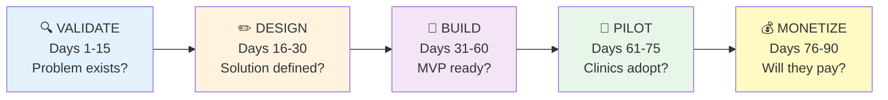
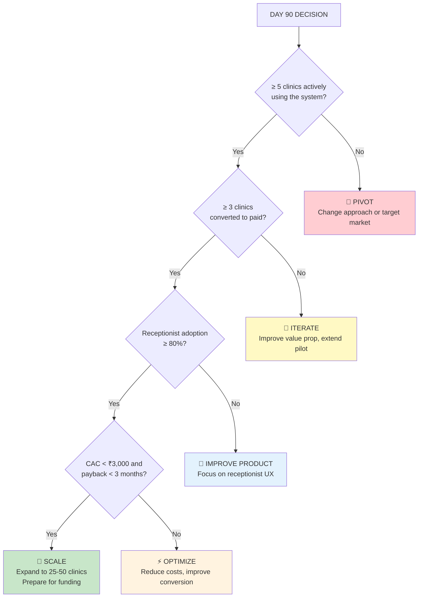

# MediBooking.in — Execution Playbook & KPI Dashboard

> **Date:** 1 November 2026  
> **Focus:** Actionable execution plan, KPIs, and decision framework

---

## 1. The 90-Day Battle Plan

### Phase Overview

---

### Phase 1: VALIDATE (Days 1-15)

**Goal:** Confirm clinics actually have this problem and want it solved.

| Day | Activity | Output |
|-----|----------|--------|
| 1-3 | Map 200 clinics in MP Nagar + Arera Colony + Kolar | Clinic directory spreadsheet |
| 4-5 | Contact and schedule 20 doctor interviews | Interview calendar |
| 6-10 | Conduct 20 doctor interviews (see questionnaire below) | Interview summaries |
| 8-10 | Conduct 10 receptionist interviews | Workflow maps |
| 10-13 | Survey 30 patients (at clinic waiting rooms) | Patient insights |
| 14-15 | Analyze data; shortlist 10 pilot clinics | Pilot clinic list + validation report |

**Doctor Interview Questions:**
1. How do patients currently book appointments? (Phone / WhatsApp / Walk-in / Online?)
2. How often do scheduling conflicts happen per week?
3. How do you handle cancellations?
4. What frustrates you most about managing appointments?
5. What software do you currently use?
6. Would you try a free system that unifies all bookings?
7. What monthly price would you consider reasonable?
8. Would you participate in a 30-day free pilot?

**Receptionist Interview Questions:**
1. How do you currently record appointments?
2. How many phone calls for bookings do you handle per day?
3. How do you know if a slot is available?
4. What's the most repetitive task in your day?
5. What would make a new booking system hard to use?
6. What information do you need on one screen?

**Phase 1 Go/No-Go:**

| Signal | Go ✅ | No-Go ❌ |
|--------|------|---------|
| Scheduling problems | 15+ of 20 doctors confirm | < 8 confirm |
| Willingness to try | 10+ doctors agree to pilot | < 5 agree |
| Receptionist openness | 7+ open to new system | < 4 open |
| Payment willingness | 5+ mention paying for solution | 0 would pay |

---

### Phase 2: DESIGN (Days 16-30)

| Day | Activity | Output |
|-----|----------|--------|
| 16-18 | Finalize business model based on validation | Business model canvas |
| 19-22 | Design user flows (patient, doctor, receptionist) | Wireframes |
| 23-25 | Define appointment state machine + RBAC | Technical spec |
| 26-28 | Draft privacy policy + terms of service | Legal documents |
| 29-30 | Secure 5-10 pilot clinic commitments (signed letters/emails) | Pilot agreements |

---

### Phase 3: BUILD (Days 31-60)

**Sprint Plan (2-week sprints):**

| Sprint | Features | Definition of Done |
|--------|----------|-------------------|
| Sprint 1 (D31-44) | Auth + OTP login, Doctor/Clinic profiles, Availability management | Doctor can create profile and set available slots |
| Sprint 2 (D45-58) | Appointment booking, Receptionist dashboard, Walk-in/phone entry | Receptionist can manage all booking types in one screen |
| Sprint 3 (D55-60) | WhatsApp notifications, Cancellation/rescheduling, Patient booking UI | Patient can book, get confirmed, and cancel via web + WhatsApp |

**Testing Priorities:**
- ✅ Two patients booking same slot → only one succeeds
- ✅ Duplicate request → no phantom appointment
- ✅ Receptionist walk-in → slot immediately unavailable online
- ✅ Doctor cancels → patient notified
- ✅ Unauthorized access → blocked and logged

---

### Phase 4: PILOT (Days 61-75)

| Day | Activity | Metric to Track |
|-----|----------|----------------|
| 61-63 | Deploy to production; onboard first 3 clinics | System uptime |
| 64-67 | Train receptionists at each clinic (2-hour sessions) | Training completion |
| 68-70 | Expand to remaining pilot clinics | Clinics live |
| 71-73 | Daily error review + patient feedback collection | Error rate, NPS |
| 74-75 | Pilot performance review with each clinic | Usage metrics |

---

### Phase 5: MONETIZE (Days 76-90)

| Day | Activity | Metric to Track |
|-----|----------|----------------|
| 76-78 | Present value report to each pilot clinic | Doctor engagement |
| 79-82 | Offer paid plans (₹999-2,499/mo) | Conversion rate |
| 83-85 | Handle objections, adjust pricing if needed | Feedback patterns |
| 86-88 | Process first payments | Revenue |
| 89-90 | Final go/no-go decision | All metrics below |

---

## 2. KPI Dashboard

### Product Metrics

| Metric | Definition | Target (Day 90) | Red Flag |
|--------|-----------|-----------------|----------|
| **Active Clinics** | Clinics with ≥1 booking action in last 7 days | ≥ 8 | < 3 |
| **Booking Conversion Rate** | Successful bookings / booking attempts | ≥ 85% | < 70% |
| **Appointments per Clinic/Week** | Average bookings managed per active clinic | ≥ 20 | < 5 |
| **No-Show Rate** | No-shows / confirmed appointments | < 15% | > 25% |
| **Receptionist Adoption** | % of onboarded clinics where receptionist uses daily | ≥ 80% | < 50% |
| **Patient Self-Bookings** | % of bookings made by patients (vs. receptionist) | ≥ 20% | < 5% |
| **Booking Error Rate** | Failed/inconsistent bookings / total bookings | < 2% | > 5% |
| **Slot Accuracy** | Displayed availability matches actual clinic availability | ≥ 95% | < 85% |
| **Notification Delivery** | WhatsApp/SMS delivered / sent | ≥ 95% | < 85% |

### Financial Metrics

| Metric | Definition | Target (Day 90) | Red Flag |
|--------|-----------|-----------------|----------|
| **Paying Clinics** | Clinics on paid plan | ≥ 3 | 0 |
| **MRR** | Monthly Recurring Revenue | ≥ ₹5,000 | ₹0 |
| **CAC** | Cost to acquire one paying clinic | < ₹3,000 | > ₹10,000 |
| **Contribution Margin** | (Revenue - Variable Costs) / Revenue | ≥ 60% | < 40% |
| **30-Day Retention** | % clinics still active after 30 days | ≥ 90% | < 70% |
| **Free-to-Paid Conversion** | % pilot clinics converting to paid | ≥ 30% | < 10% |

### Operational Metrics

| Metric | Definition | Target | Red Flag |
|--------|-----------|--------|----------|
| **Support Tickets per Clinic/Week** | Average support requests | < 2 | > 5 |
| **Onboarding Time** | Time from first contact to live clinic | < 7 days | > 21 days |
| **System Uptime** | Platform availability | ≥ 99.5% | < 98% |
| **Page Load Time** | Patient booking page | < 3 seconds | > 6 seconds |

---

## 3. Day 90 Decision Framework

---

## 4. Monthly Review Template

### Monthly Business Review Agenda

| # | Topic | Duration | Owner |
|---|-------|----------|-------|
| 1 | KPI dashboard review (all metrics above) | 15 min | Founder |
| 2 | Clinic churn analysis (who left and why?) | 10 min | Founder |
| 3 | Top 3 product issues from clinic feedback | 10 min | Product |
| 4 | Competitive landscape changes | 5 min | Founder |
| 5 | Next month's targets and priorities | 10 min | Founder |
| 6 | Budget and runway review | 10 min | Finance |

### Clinic Health Scorecard (Per Clinic)

| Metric | Green ✅ | Yellow ⚠️ | Red ❌ |
|--------|---------|-----------|--------|
| Weekly bookings | > 20 | 5-20 | < 5 |
| Receptionist daily logins | 5+ days/week | 3-4 days | < 3 days |
| Patient self-bookings | > 30% | 10-30% | < 10% |
| Support tickets | 0-1/week | 2-3/week | 4+/week |
| Payment status | Current | 15 days overdue | 30+ days overdue |

---

## 5. Startup Funding Readiness Checklist

### What Investors Want to See (Seed Stage, 2026)

| Requirement | MediBooking.in Status | Action Needed |
|-------------|----------------------|---------------|
| Problem validated with real users | 🔴 Not started | Complete Day 1-15 validation |
| Working MVP | 🔴 Not started | Build by Day 60 |
| Paying customers | 🔴 Not started | Convert by Day 90 |
| Unit economics (CAC, LTV, margin) | 🔴 Not started | Calculate from pilot data |
| Repeatable onboarding process | 🔴 Not started | Document after 10+ onboardings |
| Hindi-first product | 🔴 Not started | Design from Day 1 |
| DPDP compliance plan | 🔴 Not started | Draft by Day 30 |
| AI roadmap | 🔴 Not started | Include in pitch deck |
| Team (or solo founder story) | 🟡 Partial | Document founder strengths |
| Company registration | 🔴 Not started | Register before pilot |

### Pitch Deck Outline (For Future Use)

1. **Problem:** Scheduling chaos in India's 1.7M independent clinics
2. **Solution:** Clinic-first booking platform — unified scheduling for doctors, receptionists, and patients
3. **Why Now:** ABDM push, WhatsApp-first India, Tier-2 digital wave, post-COVID health-tech adoption
4. **Market:** USD 1.7B India e-health (22% CAGR); target 200K+ Tier-2/3 independent clinics
5. **Product:** Demo of booking flow, receptionist dashboard, WhatsApp integration
6. **Traction:** X paying clinics, Y bookings/month, Z% receptionist adoption, W% conversion
7. **Business Model:** SaaS subscriptions (₹999-2,499/mo); ~75% contribution margin
8. **Competition:** Practo = expensive + national; Drlogy = no local presence; MediBooking = affordable + local + Hindi
9. **Team:** Founder story, domain expertise, Bhopal market access
10. **Ask:** ₹25-50L seed for 6-month expansion to 100+ clinics + team hire

---

## 6. Key Resources & References

### Market Research Sources
- India E-Health Market: Ken Research (USD 1.70B, 22% CAGR)
- Healthcare Scheduling Software: Grand View Research, TrendX Insights
- DPDP Act: Ministry of Electronics & IT, Legal500, PwC India
- Bhopal Healthcare: AI Doctor Growth, Doxxy.in, Digital Health News

### Regulatory References
- [DPDP Act 2023](https://www.meity.gov.in/) — Ministry of Electronics & IT
- [DPDP Rules 2025](https://www.pib.gov.in/PressReleasePage.aspx?PRID=2190014) — PIB notification
- [Telemedicine Practice Guidelines](https://www.mohfw.gov.in/pdf/Telemedicine.pdf) — MoHFW
- [ABDM / ABHA](https://abdm.gov.in/) — National Health Authority
- [Healthcare Professionals Registry](https://ahpr.abdm.gov.in/about) — ABDM

### Competitor References
- [Practo](https://www.practo.com/doctors) — Doctor discovery & SaaS
- [Drlogy](https://drlogy.com) — Clinic management SaaS
- [DocEngage](https://docengage.in) — Healthcare CRM
- [Tata 1mg](https://www.1mg.com/doctors) — Doctor listing & e-pharmacy

---

*This playbook is a living document. Update after each phase completion.*

