# MediBooking.in — Real-World Clinic Workflow & Functional Feature Specification

> **Document ID:** MB-SPEC-06  
> **Prepared by:** Multidisciplinary Product Strategy Team (Healthcare BA, Indian Healthcare Market Researcher, Clinic Workflow Specialist, Doctor & Receptionist UX Researcher, SaaS Pricing Strategist, Product Manager)  
> **Market Target:** Bhopal, Madhya Pradesh (Tier-2 Indian Clinic Ecosystem)  
> **Version:** 1.0 (Pre-Implementation Baseline)  
> **Status:** Approved for Technical Architecture Planning

---

## Executive Summary & Analytical Grounding

This specification provides the operational foundation, feature inventory, and detailed workflows for **MediBooking.in**. Unlike corporate healthcare networks or metro-centric hospital aggregators, private outpatient healthcare in Tier-2 Indian cities like Bhopal is driven by **hyper-fragmented, semi-digitized independent practitioners and small polyclinics**.

### Reality Check: Bhopal Outpatient Operations

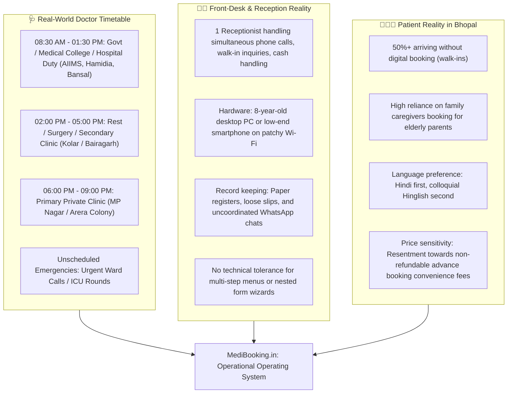

### Fact vs. Assumption vs. Feature Classification Matrix

To maintain rigorous product integrity, all findings are cataloged into four distinct categories:

| Tag | Category | Meaning in this Specification |
|:---|:---|:---|
| `[FACT]` | **Empirical Reality** | Grounded in verified healthcare operational patterns and Indian healthtech benchmarks. |
| `[ASSUMPTION]` | **Planning Hypothesis** | Needs empirical validation during the Bhopal Phase 1 pilot before hard-coding. |
| `[FEATURE]` | **Engineered Solution** | Functional capability built into MediBooking.in to resolve a specific friction point. |
| `[PREFERENCE]` | **Clinic-Configurable** | Policy left strictly to the discretion of the individual doctor or clinic owner. |

---

## 1. Problem 1: Doctor Availability & Complex Scheduling

### 1.1 The Operational Anatomy of Doctor Time in India

`[FACT]`: In small Indian clinics, a doctor is rarely a full-time, 9-to-5 fixture. A single practitioner typically balances:
1. **Institutional Commitments:** Morning government hospital duties (e.g., Gandhi Medical College / Hamidia, AIIMS Bhopal) or consultant rounds at private tertiary hospitals (e.g., Bansal, Chirayu).
2. **Multi-Clinic Splitting:** Morning clinic in Old Bhopal (e.g., Chowk/Itwara) and evening clinic in New Bhopal (e.g., MP Nagar or 10 No. Market, Arera Colony).
3. **Emergency Disruption:** Obstetricians called for emergency deliveries, surgeons for trauma admissions, cardiologists for emergency catheterizations.
4. **Fatigue & Session Caps:** Doctors cannot see infinite patients; after 30 intensive consultations, clinical judgment degrades.

`[FEATURE]`: MediBooking **must decouple a Doctor's global identity from their local Clinic Presence**. A doctor's working schedule exists strictly as an affiliation-specific recurring session, never as a generic calendar block.

### 1.2 Data Relationship Hierarchy

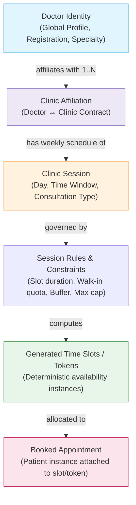

### 1.3 Key Functional Availability Capabilities

#### 1. Multi-Session Recurring Schedules
- Allows configuration such as:
  - *Monday/Wednesday/Friday:* 06:00 PM – 08:30 PM at **City Care Clinic (MP Nagar)**
  - *Tuesday/Thursday/Saturday:* 06:30 PM – 09:00 PM at **Arogya Polyclinic (Arera Colony)**
  - *Sunday:* Emergency on-call only (No pre-bookable slots)

#### 2. Slot Generation vs. Token-Based Queuing
`[PREFERENCE]`: Some doctors work strictly on **Fixed Time-Slots** (e.g., 15-minute intervals), while others work on **Numbered Token Sessions** (e.g., "Session starts at 6:30 PM, you are Token #12, arrive between 7:00 PM and 7:30 PM"). MediBooking supports both:
- **Slot Mode:** Exact slot allocation (`06:00 PM`, `06:15 PM`, `06:30 PM`).
- **Token Mode:** Dynamic estimated arrival window based on rolling average consultation speed.

#### 3. Capacity Caps & Split Quotas
`[FEATURE]`: To protect clinic operations, every session enforces a hard ceiling with segregated channel quotas:
- **Total Session Cap:** E.g., Maximum 25 patients.
- **Online Booking Quota:** 12 slots released to the web.
- **Reception / Walk-in / Phone Quota:** 13 slots reserved for the front desk.
- **Dynamic Spillover:** If online slots are unbooked 60 minutes before session start, they automatically release into the front-desk walk-in pool.

#### 4. Delay & Emergency Propagation Engine
`[FACT]`: Doctors running late (e.g., stuck in hospital OT for 45 minutes) is the #1 cause of waiting room unrest in Bhopal clinics.
`[FEATURE]`: **1-Click Session Shift**:
- Doctor or receptionist clicks: *"Doctor Delayed by [15 / 30 / 45 / 60] Minutes"*.
- The engine instantly shifts all downstream unstarted slot start times.
- Automated WhatsApp broadcast fires to booked patients:
  > *"Namaste [Patient Name], Dr. Sharma is attending an emergency and is running 30 minutes late. Your revised estimated consultation time at City Clinic is now 07:15 PM instead of 06:45 PM. You may plan your arrival accordingly."*
- Reception dashboard displays real-time revised schedules, immediately reducing crowded waiting area tension.

#### 5. Emergency Session Cancellation & Rerouting
`[FEATURE]`: When a doctor cancels a session completely due to illness or personal emergency:
1. Session status changes to `CANCELLED_BY_DOCTOR`.
2. All online slot booking for that session is locked instantly.
3. Batch notification triggers via WhatsApp/SMS with options:
   - **Option A (1-Click Rebook):** Automatically move to the next available session of the same doctor.
   - **Option B (Refund/Cancel):** If any advance booking fee was collected, trigger immediate gateway refund webhook without penalties.
4. Receptionist gets a prioritized "Call Back" list for patients without WhatsApp to ensure no patient travels fruitlessly from distant locations (e.g., Mandideep, Sehore, Raisen).

---

## 2. Problem 2: Unifying Online & Offline Patients

### 2.1 The Multi-Channel Reality

In Bhopal clinics, appointments arrive through at least six distinct channels. Without a single source of truth, double-booking and desk friction are mathematically inevitable.

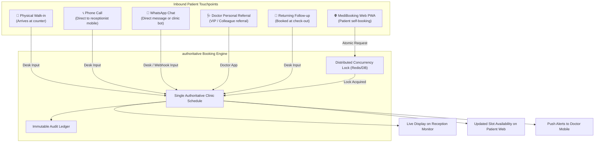

### 2.2 Concurrency Control & Double-Booking Elimination

`[FACT]`: A catastrophic failure in clinic scheduling occurs when an online patient confirms a 07:00 PM slot while the receptionist is concurrently assigning that same slot to an elderly patient standing at the counter.

`[FEATURE]`: **Two-Phase Slot Reservation Protocol (Backend Authoritative)**:

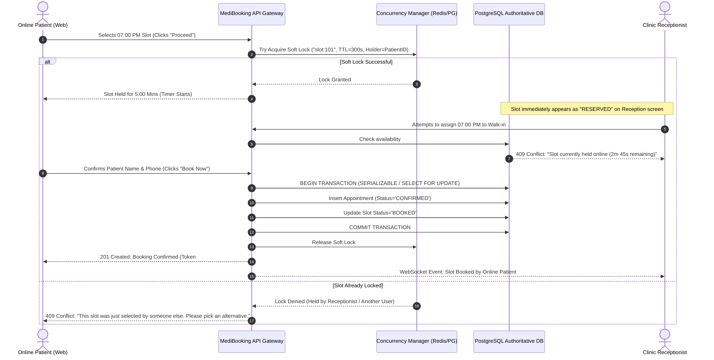

### 2.3 The Waiting-List Engine (Zero Waste Policy)

`[ASSUMPTION]`: Between 15% and 25% of clinic appointments in Bhopal end in no-shows or late cancellations.
`[FEATURE]`: **Automated Standby Queue**:
1. When all primary slots for an evening session are booked, the UI presents an **"Add to Waitlist"** button (capped at 5 waitlist tokens per session).
2. If a booked patient cancels or is marked `NO_SHOW` by the receptionist, the system instantly triggers an automated WhatsApp prompt to Waitlist Candidate #1:
   > *"A slot has opened up with Dr. Sharma for today at 07:45 PM. Tap [ACCEPT WITHIN 10 MINS] to claim this appointment."*
3. If unaccepted within 10 minutes, the offer automatically cascades to Waitlist Candidate #2.
4. Eliminates empty doctor chair time while keeping waitlist expectations transparent.

---

## 3. Receptionist Operating System (Front-Desk UX)

### 3.1 The Front-Desk Persona & Ergonomic Constraints

`[FACT]`: In typical Bhopal clinics (MP Nagar, Kolar, Old City), receptionists:
- Range from 20 to 45 years old, earning ₹8,000 – ₹18,000/month.
- Are frequently interrupted mid-task by ringing landlines, doctors giving verbal instructions, and impatient walk-in patients.
- Use dated desktop monitors (1366x768 resolution) or basic Android tablets.
- Possess low patience for complex forms; if a software task takes >30 seconds, they will revert immediately to their paper notebook.

`[FEATURE]`: **The 15-Second Reception Interaction Rule**: Every core action (Add Walk-In, Mark Arrived, Reschedule) must be executable within **under 3 clicks or 15 seconds**.

### 3.1.1 Dual Receptionist Operational Scopes (Clinic-Based vs. Doctor-Dedicated)

`[FACT]`: In Indian outpatient facilities, receptionists fall into two distinct operational categories:
1. **Clinic-Based Receptionist (`CLINIC_WIDE`):** Employed by the polyclinic. Sits at the central entrance reception desk. Manages appointments, phone calls, walk-in registrations, and cash/UPI payments for **all consulting doctors and specialties** across the entire clinic.
2. **Doctor-Dedicated Receptionist / Attendant (`DOCTOR_DEDICATED`):** Employed directly by a specific doctor (e.g. Dr. Sharma's personal compounder or Dr. Saxena's nurse). Sits immediately outside that doctor's chamber. When this user logs in, their dashboard is scoped exclusively to their assigned doctor's queue, slots, and patient arrivals.

MediBooking natively supports both models simultaneously in any clinic via role scoping.

### 3.2 Reception Dashboard Layout Blueprint (Multi-Doctor Clinic View)

```
+-------------------------------------------------------------------------------------------------------------+
| MEDIBOOKING CLINIC OS  |  Arogya Polyclinic - Arera Colony  | [Logged in: Suman (Front Desk)]  | [🏢 Clinic View] |
+-------------------------------------------------------------------------------------------------------------+
| DOCTOR CHAMBERS: [🟢 Dr. Alok Sharma (Ortho - Ch 1)]  [🟡 Dr. Neha Gupta (Pediatric - Ch 2)]  [⚪ Dr. Verma (GP)] |
+-------------------------------------------------------------------------------------------------------------+
| 🔍 Quick Search (Name / Mobile): [                     ]  | [+ Fast Walk-In (F2)] | [⏰ Delay Chamber Doctor] |
+-------------------------------------------------------------------------------------------------------------+
| ACTIVE CHAMBER: Dr. Alok Sharma (Orthopedic) | 14/25 Seen | Avg Consult: 9m | Chamber Delay: +15m           |
+-------------------------------------------------------------------------------------------------------------+
|                                    LIVE APPOINTMENT & CHAMBER QUEUE BOARD                                   |
+------+---------+----------------------+------------+--------------+-------------------+---------------------+
| Token| Slot    | Patient Name         | Type       | Source       | Status            | Quick Actions       |
+------+---------+----------------------+------------+--------------+-------------------+---------------------+
| #01  | 06:00 PM| Rajesh Verma (48M)   | Follow-up  | Online       | 🟢 COMPLETED      | [View Receipt]      |
| #02  | 06:12 PM| Anita Dubey (34F)    | New Visit  | Phone Call   | 🟢 COMPLETED      | [View Receipt]      |
| #03  | 06:25 PM| Om Prakash (62M)     | New Visit  | Walk-In      | 🩺 IN CHAMBER 1   | [Finish & Bill]     |
| #04  | 06:40 PM| Vikram Singh (29M)   | Report     | Online       | 🟡 WAITING (12m)  | [Send to Ch 1]      |
| #05  | 06:50 PM| Baby of Pooja (2M)   | New Visit  | Walk-In      | 🟡 WAITING (4m)   | [Prioritize Urgent] |
| #06  | 07:05 PM| Sunil Jain (41M)     | Follow-up  | WhatsApp Bot | 🔵 ARRIVED (Desk) | [Check-In]          |
| #07  | 07:15 PM| Geeta Bai (55F)      | New Visit  | Phone Call   | ⚪ NOT ARRIVED    | [Call] [Mark NoShow]|
| #08  | 07:30 PM| Kapil Sahu (38M)     | New Visit  | Online       | ⚪ NOT ARRIVED    | [Send WhatsApp Ping]|
+------+---------+----------------------+------------+--------------+-------------------+---------------------+
| ⚡ KEYBOARD SHORTCUTS: [F2] New Walk-In | [F3] Switch Chamber | [F4] Next Patient | [F8] Collect Cash        |
+-------------------------------------------------------------------------------------------------------------+
```

### 3.3 Dynamic Front-Desk Queue Management in Chaos Conditions

#### The 5-Scenario Conflict Engine

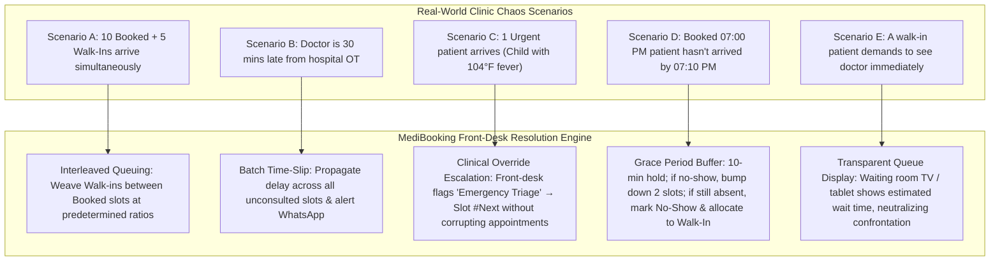

---

## 4. Minimal Patient Data & Privacy-Conscious Architecture

### 4.1 Minimal Data Registration Philosophy

`[FACT]`: Asking for extensive medical history, past diagnoses, or Aadhaar numbers during simple outpatient clinic registration creates massive drop-offs, triggers patient suspicion, and dramatically expands liability under India's **Digital Personal Data Protection (DPDP) Act 2023**.

`[FEATURE]`: MediBooking institutes **Strict Purpose Limitation**. Administrative registration captures **only what is necessary to safely identify the patient, schedule the visit, and notify them**.

### 4.2 Data Classification & Storage Matrix

| Data Element | Field Type | Collection Phase | Justification | DPDP Sensitivity | Storage & Access Scope |
|:---|:---|:---|:---|:---|:---|
| **Patient Full Name** | String (Mandatory) | Intake | Identification & Doctor greeting | Basic Personal Data | Reception + Doctor + Invoice |
| **Mobile Number** | String (10-digit India) | Intake | OTP, Booking confirmation, Delays | Basic Personal Data | Encrypted at rest; masked in audit logs |
| **Age / Gender** | Integer / Enum | Intake | Baseline clinical context (Pediatric vs Geriatric) | Basic Demographic | Reception + Doctor |
| **Locality / Area** | String (Optional) | Intake | Geo-routing & catchment analytics | Basic Demographic | Reception + Analytics |
| **Unique Patient ID (UHID)** | UUID / Short Hash | Auto-generated | De-duplicating repeat clinic visits | System Identifier | Internal index across all clinic modules |
| **Blood Group** | Enum (Optional) | Optional Profile | **HEALTH DATA** — Only if patient explicitly enters | **Sensitive Personal Data** | **Doctor Only** (Hidden from reception by default) |
| **Emergency Contact** | String (Optional) | Specific clinics | Required for minor surgeries / elderly | Personal Data | Accessible only in Patient Profile modal |
| **Clinical Symptoms / Reason** | Free text (Max 100 ch) | Online Booking | Triage routing (e.g. "Knee pain") | **Sensitive Health Data** | **Doctor View Only** (Reception sees token type only) |

### 4.3 The Privacy-Preserving Prescription Administrative Workflow

`[FACT]`: In standard Indian clinics, prescriptions contain highly sensitive diagnoses (e.g., psychiatric evaluations, reproductive health, sexually transmitted infections, oncology referrals). Receptionists and billing clerks **must never have unrestricted view access to diagnosis and drug regimens**.

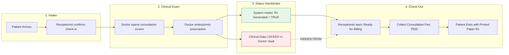

### 4.4 Role-Based Access Control (RBAC) Permitted Actions (5 Roles & Scopes)

| Platform Role & Scope | View Appointments | Create / Reschedule | View Patient Contact | View Clinical Reason | View Prescription Contents | Manage Billing & Invoices | View Clinic Financials |
|:---|:---:|:---:|:---:|:---:|:---:|:---:|:---:|
| **1. Super Admin** | ❌ Denied | ❌ Denied | ❌ Denied | ❌ Denied | ❌ Denied | ❌ Denied | ✅ Platform Subscriptions Only |
| **2. Clinic Admin (Owner/Manager)** | ✅ All Chambers | ✅ Full | ✅ Full | ❌ Denied | ❌ Denied | ✅ Full | ✅ Clinic Wide Financials & Analytics |
| **3. Doctor** | ✅ Own Chamber | ✅ Full | ✅ Full | ✅ Full | ✅ Full (Author) | ✅ Own Collections | ✅ Own Revenue Analytics |
| **4a. Receptionist (Clinic-Wide Scope)** | ✅ All Chambers | ✅ All Doctors | ✅ Limited (Masked) | ❌ Denied | ❌ Denied (Status only) | ✅ All Chambers | ❌ Denied (Daily shift cash only) |
| **4b. Receptionist (Doctor-Dedicated Scope)** | ✅ Assigned Doctor Only | ✅ Assigned Doctor Only | ✅ Limited (Masked) | ❌ Denied | ❌ Denied (Status only) | ✅ Assigned Doctor Only | ❌ Denied |
| **5. Patient / Caregiver** | ✅ Self Only | ✅ Self Only | ✅ Self Profile | ✅ Self Only | ✅ Issued to Self | ✅ Self Receipts | ❌ Denied |

---

## 5. Business Model: Multi-Tiered Subscription SaaS

### 5.1 Clear Separation of Platform Fee vs. Consultation Fee

`[FACT]`: MediBooking **does not take a cut or commission of the doctor's consultation fee**.
- Doctor charges: Set by the doctor (e.g., ₹300, ₹500, ₹1,200). MediBooking touches ₹0 of this in the pure SaaS model.
- Clinic pays MediBooking: A predictable, monthly or annual recurring SaaS subscription for the software operating system.
- Why this wins in Bhopal: Doctors in Tier-2 India intensely dislike "percentage-of-OPD" commissions (associating it with exploitative aggregator models like early Practo). A clean, predictable SaaS license fosters trust and fast onboarding.

### 5.2 Subscription Pricing Tiers (Hypotheses to Validate)

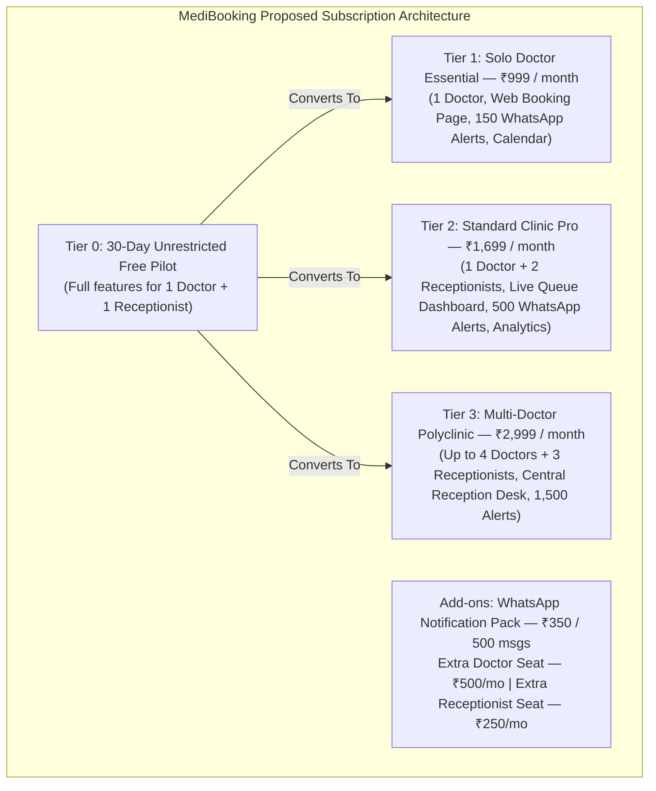

### 5.3 Subscription Lifecycle & Billing Automation

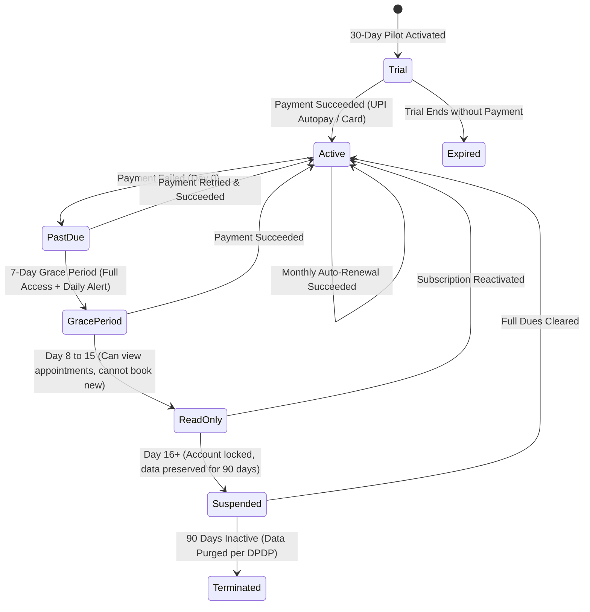

#### Financial & Invoicing Capabilities:
- **GST Compliance:** Automated generation of GST-compliant B2B invoices with clinic GSTIN, HSN code `998314` (Information technology software services), state code (23 for MP), and SGST/CGST split.
- **UPI Autopay Integration:** Direct recurring mandate setup via NPCI UPI Autopay (PhonePe, Google Pay, Paytm) to achieve sub-2% payment churn without credit card dependency.

---

## 6. Financial Architecture: Decoupled Payment Flows

### 6.1 The Three Independent Financial Flows

```mermaid
flowchart TD
    subgraph FlowA["FLOW A: MediBooking B2B SaaS Subscription"]
        ClinicAccount["Clinic / Doctor Bank Account"] -->|UPI Autopay / Netbanking| PG_MB["MediBooking Payment Gateway (Razorpay/Cashfree)"]
        PG_MB -->|Settlement T+1| MBAcct["MediBooking Corporate Current Account"]
        MBAcct -->|Auto Invoice + GST| ClinicAccount
    end

    subgraph FlowB["FLOW B: In-Clinic Direct Consultation Payment (90%+ of Volume)"]
        PatB["In-Person Patient"] -->|Cash at Desk| RecDesk["Receptionist Cash Drawer"]
        PatB -->|Direct Scan Clinic UPI QR| DocUPI["Doctor / Clinic Dedicated Soundbox / UPI VPA"]
        RecDesk -->|Desk Marks: PAID (CASH)| RecLedger["Clinic Internal Shift Reconciliation"]
        DocUPI -->|Desk Marks: PAID (UPI)| RecLedger
    end

    subgraph FlowC["FLOW C: Online Booking Advance / Convenience Payment"]
        PatC["Online Patient"] -->|Online UPI / Card| PG_ESCROW["Escrow / Split Payment Gateway"]
        PG_ESCROW -->|Direct Route Consultation Fee| DocBank["Doctor Bank Account (Direct Settlement)"]
        PG_ESCROW -->|Platform Booking Fee (If any)| MBAcct
    end

    style FlowA fill:#e8f5e9,stroke:#2e7d32
    style FlowB fill:#fff3e0,stroke:#e65100
    style FlowC fill:#e1f5fe,stroke:#0277bd
```

### 6.2 Regulatory Compliance & The Marketplace Payment Trap

`[FACT]`: Under Reserve Bank of India (RBI) Payment Aggregator (PA) Guidelines:
- A platform that collects money from consumers on behalf of merchants (doctors) and subsequently settles funds to them is legally designated as a **Payment Aggregator**.
- Operating a PA model requires RBI license capitalisation (₹15 Crore net worth requirement) or strict escrow settlement account architectures (e.g., Razorpay Route / Cashfree Split).
- If MediBooking holds patient consultation fees in its own bank account and pays doctors later, it **violates RBI guidelines**.

`[FEATURE]`: **MediBooking Phase 1 Payment Decoupling Strategy**:
1. **Flow A (Platform SaaS):** MediBooking uses a standard Indian Payment Gateway account solely for collecting its own B2B SaaS subscription fees.
2. **Flow B (Clinic Consultations):** 100% decentralized. The patient pays the clinic directly. The receptionist logs "Paid Cash" or "Paid UPI" for bookkeeping. MediBooking never touches these funds.
3. **Flow C (Advance Online Booking Policy):**
   - **Recommended Default:** `PAY_AT_CLINIC` (₹0 online commitment). High adoption, zero payment friction.
   - **Optional Anti-No-Show Tier:** Clinic can link their *own* Razorpay/UPI gateway keys directly. Funds settle directly from patient to doctor's account. MediBooking remains an un-intermediated technology provider.

---

## 7. Multi-Tenant Configuration & Customization Framework

### 7.1 Architecture: Shared Database with Strict Row-Level Tenant Isolation

`[FACT]`: For early-stage multi-tenant SaaS scaling across 50 to 1,000 clinics, creating separate databases or separate database schemas for each clinic adds massive operational overhead (schema migrations, backup orchestration, connection pool exhaustion) without justifiable ROI.

`[FEATURE]`: **Logical Tenant Partitioning with PostgreSQL Row-Level Security (RLS)**:
- Every tenant-owned table contains `clinic_id UUID NOT NULL REFERENCES clinics(id)`.
- Global database connection context sets `current_setting('app.current_clinic_id')`.
- Database RLS policies automatically prevent cross-tenant data leakage even in the event of an application-level bug.

### 7.2 Configuration vs. Templates vs. Custom Code

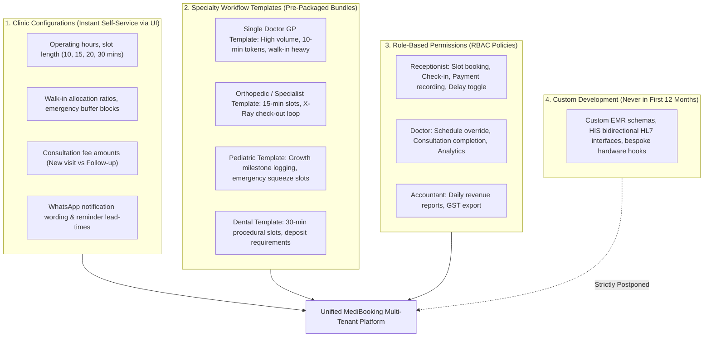

---

## 8. End-to-End Operational Workflows (Bhopal Field Mappings)

### Workflow 1: Doctor-Centric Online Appointment Journey

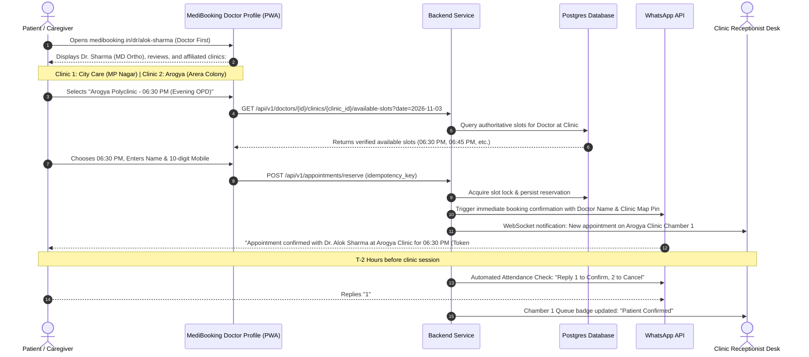

### Workflow 2: Phone Call Booking Flow (Front-Desk)

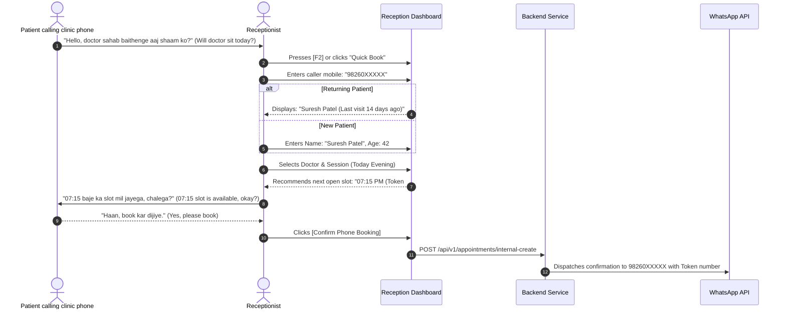

### Workflow 3: Walk-in Registration & Queue Interleaving

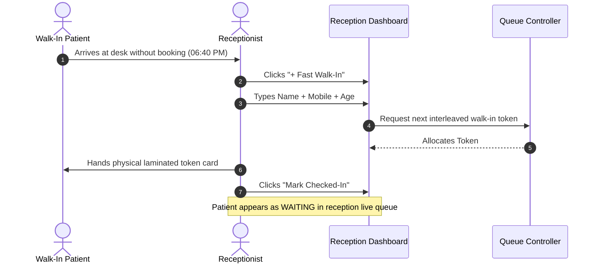

### Workflow 4: Doctor Delay & WhatsApp Broadcast Flow

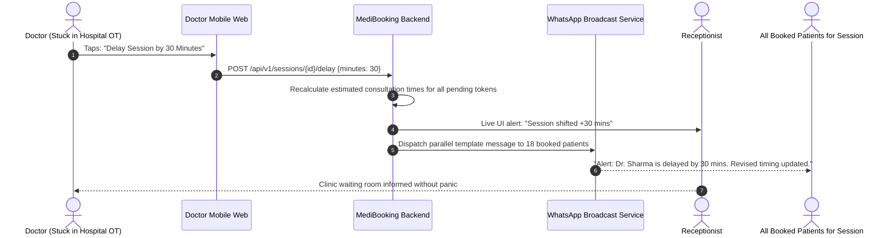

---

## 9. Comprehensive Functional Feature Matrix

### P0: Essential for Bhopal Pilot Launch (Must-Have)

| Module | Feature Name | Description & Functional Specification |
|:---|:---|:---|
| **Identity & Access** | Multi-Role Phone OTP Auth | Secure authentication via SMS/WhatsApp OTP for Patients, Doctors, and Receptionists. No passwords required. |
| **Identity & Access** | Role-Based Authorization | Strict permission isolation between Doctor, Receptionist, and Clinic Owner. |
| **Doctor Availability** | Multi-Session Weekly Scheduler | Configure recurring day/time windows per clinic affiliation with slot lengths (10, 15, 20, 30 min). |
| **Doctor Availability** | 1-Click Leave & Emergency Block | Instant block of future slots with automated notification to already booked patients. |
| **Doctor Availability** | Doctor Delay Adjuster | Shift downstream session times by 15/30/45/60 minutes with automated WhatsApp notifications. |
| **Booking Engine** | Unified Schedule Engine | Single authoritative store handling Online, Phone, Walk-in, and WhatsApp bookings. |
| **Booking Engine** | Double-Booking Concurrency Lock | Backend database transaction locking preventing double-allocation of any slot. |
| **Front-Desk OS** | 15-Second Walk-In Entry | Minimalist patient intake modal requiring only Name, Mobile, Age, and Visit Type. |
| **Front-Desk OS** | Live Front-Desk Queue Board | Single-screen view of today's patients with 1-click status transitions: `Arrived`, `Waiting`, `In-Consult`, `Completed`. |
| **Front-Desk OS** | Phone Booking Quick-Entry | Rapid slot search and telephone reservation module. |
| **Front-Desk OS** | Manual Payment Logger | Record Cash vs Direct UPI payment received at reception with automated receipt generation. |
| **Patient Web** | Mobile-Responsive Booking PWA | Zero-installation, fast-loading web app in Hindi and English with live verified slot view. |
| **Patient Web** | Caregiver Booking Mode | Allows a son/daughter to easily book an appointment on behalf of elderly parents. |
| **Communications** | WhatsApp Booking Confirmation | Automated transactional WhatsApp template sending token, clinic address, and Google Maps pin. |
| **Communications** | T-2 Hour WhatsApp Reminder | Automated reminder with 1-tap confirmation or cancellation action. |
| **Clinic SaaS** | Subscription Management | Plan management for Basic, Standard, and Polyclinic tiers with automated trial tracking. |

### P1: Fast-Follow Enhancements (Post-Pilot Validation)

| Module | Feature Name | Description & Functional Specification |
|:---|:---|:---|
| **Front-Desk OS** | Waiting Room TV Queue Display | Lightweight fullscreen URL displaying current Token in consultation and next 5 tokens for waiting room TV. |
| **Communications** | WhatsApp Standby Waitlist Bot | Interactive bot that offers newly opened slots to waitlist patients automatically. |
| **Clinic SaaS** | UPI Autopay Mandates | Automated monthly subscription renewal via PhonePe / Google Pay / Paytm mandates. |
| **Clinic SaaS** | GST Invoice Generator | Automated B2B tax invoice generation for clinic subscribers. |
| **Analytics** | Daily Front-Desk Audit Report | End-of-day summary of total footfall, no-show rate, average consultation duration, and cash collections. |
| **Doctor Portal** | Doctor Mobile Daily Glance | Simplified mobile view for the doctor showing today's patient list and vital clinical notes. |
| **Admin** | Doctor Credential Verification Desk | Platform back-office tool to verify state medical council numbers against official registries. |

### P2: Advanced Capabilities (Scale & Expansion Phase)

| Module | Feature Name | Description & Functional Specification |
|:---|:---|:---|
| **Integrations** | ABDM / ABHA Health ID Creation | Voluntary capture and linking of patient ABHA IDs into the Ayushman Bharat Digital Mission. |
| **Clinical** | Digital Prescription Generator | Lightweight clinical notes and printable Rx template for doctors wishing to abandon paper. |
| **Teleconsult** | Telemedicine Video Consultation | End-to-end encrypted video bridge strictly adhering to Telemedicine Practice Guidelines 2020. |
| **Marketplace** | Local Doctor Discovery Directory | City-wide searchable portal categorized by specialty, locality (MP Nagar, Kolar), and verified reviews. |
| **Diagnostics** | Diagnostic Lab Referral Bridge | 1-click requisition sharing with partner diagnostic pathology labs in Bhopal. |

---

## 10. Summary & Sign-Off

This functional specification resolves the fundamental disconnect between generic hospital scheduling systems and the messy, high-pressure operating reality of independent clinics in Bhopal.

By prioritizing:
1. **Decoupled Doctor Affiliation Schedules**
2. **Unified Front-Desk Concurrency Control**
3. **The 15-Second Receptionist Ergonomic UX**
4. **Strict Purpose-Limited Patient Privacy**
5. **Decoupled, Regulatory-Compliant Payment Channels**

MediBooking.in establishes a high-retention, operationally resilient foundation capable of scaling from an initial 10-clinic pilot in MP Nagar to thousands of clinics across Tier-2 and Tier-3 India.

---

*Next Document in Architecture Sequence: `07-SYSTEM-ARCHITECTURE-AND-TECH-SPEC.md` (Data DDL, Transaction Boundaries, and API Contracts).*

