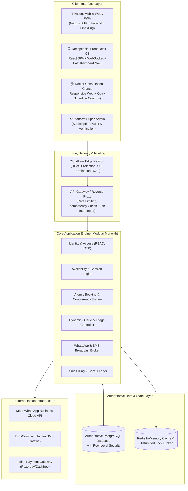
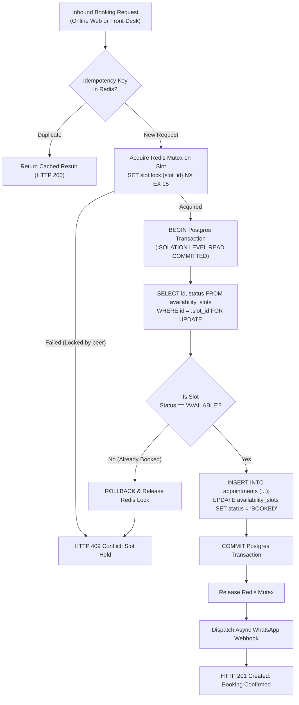
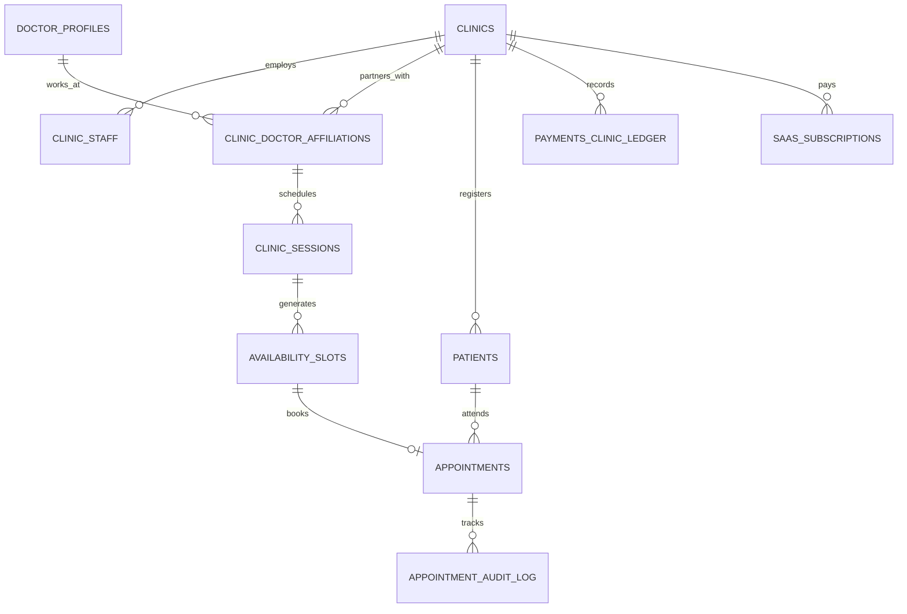

# MediBooking.in — Multi-Tenant System Architecture, Database Schema & API Specification

> **Document ID:** MB-SPEC-07  
> **Prepared by:** Software Architect (Multi-Tenant SaaS Specialist), Payment Systems Architect (India), Security & Data Compliance Specialist  
> **Target Environment:** High-Reliability, Low-Cost Cloud Architecture (PostgreSQL, Redis, Next.js, Node.js/Spring Boot)  
> **Version:** 1.0  
> **Status:** Architecture Baseline

---

## 1. System Architecture Overview

MediBooking is structured as a **modular multi-tenant system** prioritizing operational reliability, strict tenant isolation, and zero-downtime booking correctness.



---

## 2. Multi-Tenant Isolation & Security Model

### 2.1 Isolation Strategy: Shared Database with Logical Row-Level Partitioning

To balance operational simplicity, cost efficiency, and strict security during the Bhopal launch (50–500 clinics):

1. **Shared Application & Shared Database:** All clinics share a hardened PostgreSQL database instance.
2. **Mandatory Tenant Discriminator:** Every single tenant-owned table contains `clinic_id UUID NOT NULL REFERENCES clinics(id)`.
3. **Application-Level Context Injection:** Every authenticated API request resolves the caller's authorized `clinic_id` from their cryptographically signed JWT token (or session cookie).
4. **PostgreSQL Row-Level Security (RLS):** RLS policies are activated on all tenant tables, enforcing database-engine-level barriers that prevent queries from accidentally retrieving data from another clinic:

```sql
-- Database Tenant Context Enforcement Example
ALTER TABLE appointments ENABLE ROW LEVEL SECURITY;

CREATE POLICY clinic_isolation_policy ON appointments
    FOR ALL
    USING (clinic_id = NULLIF(current_setting('app.current_clinic_id', true), '')::uuid);
```

Before executing tenant queries, the backend connection executes:
```sql
SET LOCAL app.current_clinic_id = 'c4b8e8f2-8921-4f8e-bf33-281b37901cb1';
```

---

## 3. High-Concurrency Booking Engine & Correctness

### 3.1 The Double-Booking Prevention Protocol

To guarantee that an online patient and a clinic receptionist cannot claim the same appointment slot simultaneously, MediBooking enforces a **three-layered concurrency protection model**:



### 3.2 Database Engine Constraint: Mathematical Guarantee

In addition to application-level locks, the PostgreSQL database uses **Exclusion Constraints** using the `btree_gist` extension to ensure no two active appointments can overlap for the same doctor at the same time:

```sql
CREATE EXTENSION IF NOT EXISTS btree_gist;

-- Mathematical guarantee: No overlapping active appointments for the same doctor at a clinic
ALTER TABLE appointments ADD CONSTRAINT prevent_overlapping_doctor_appointments
EXCLUDE USING gist (
    clinic_doctor_id WITH =,
    tstzrange(slot_start_time, slot_end_time, '[)') WITH &&
)
WHERE (status NOT IN ('CANCELLED_BY_PATIENT', 'CANCELLED_BY_CLINIC', 'NO_SHOW'));
```

---

## 4. Complete Database Design (DDL & Entity Specification)

### 4.1 Entity Relationship Diagram



### 4.2 Production DDL Specifications

```sql
-- 1. CLINIC (TENANT ROOT)
CREATE TABLE clinics (
    id UUID PRIMARY KEY DEFAULT gen_random_uuid(),
    slug VARCHAR(64) UNIQUE NOT NULL,
    name VARCHAR(128) NOT NULL,
    legal_business_name VARCHAR(128),
    gstin VARCHAR(15),
    phone_number VARCHAR(15) NOT NULL,
    email VARCHAR(128),
    address_street TEXT NOT NULL,
    locality VARCHAR(64) NOT NULL, -- e.g. MP Nagar Zone 2, Arera Colony
    city VARCHAR(32) NOT NULL DEFAULT 'Bhopal',
    state VARCHAR(32) NOT NULL DEFAULT 'Madhya Pradesh',
    pincode VARCHAR(6) NOT NULL,
    coordinates POINT, -- Geo-coordinates for location radius search
    default_slot_duration_minutes INT NOT NULL DEFAULT 15,
    allow_online_booking BOOLEAN NOT NULL DEFAULT TRUE,
    requires_online_advance_payment BOOLEAN NOT NULL DEFAULT FALSE,
    advance_booking_fee_inr NUMERIC(8, 2) DEFAULT 0.00,
    created_at TIMESTAMPTZ NOT NULL DEFAULT NOW(),
    updated_at TIMESTAMPTZ NOT NULL DEFAULT NOW()
);

-- 2. USERS (SHARED AUTHENTICATION IDENTITIES)
CREATE TYPE user_role AS ENUM ('SUPER_ADMIN', 'CLINIC_ADMIN', 'DOCTOR', 'RECEPTIONIST', 'PATIENT');

CREATE TABLE users (
    id UUID PRIMARY KEY DEFAULT gen_random_uuid(),
    phone_number VARCHAR(15) UNIQUE NOT NULL, -- 10-digit Indian mobile
    full_name VARCHAR(128) NOT NULL,
    email VARCHAR(128),
    role user_role NOT NULL,
    is_active BOOLEAN NOT NULL DEFAULT TRUE,
    created_at TIMESTAMPTZ NOT NULL DEFAULT NOW()
);

-- 3. DOCTOR PROFILES (GLOBAL PRACTITIONER RECORD)
CREATE TABLE doctor_profiles (
    id UUID PRIMARY KEY DEFAULT gen_random_uuid(),
    user_id UUID UNIQUE NOT NULL REFERENCES users(id) ON DELETE CASCADE,
    slug VARCHAR(64) UNIQUE NOT NULL, -- e.g. "dr-alok-sharma", "dr-ritu-jain" (Primary Patient Landing URL)
    registration_number VARCHAR(64) NOT NULL, -- State Medical Council Reg No
    state_medical_council VARCHAR(128) NOT NULL, -- e.g. MP Medical Council
    primary_qualification VARCHAR(64) NOT NULL, -- MBBS, MD, MS, BDS, DM, MCh
    specialty VARCHAR(64) NOT NULL, -- e.g. Cardiology, Dermatology, Orthopedics, Pediatrics
    sub_specialties TEXT[],
    experience_years INT NOT NULL DEFAULT 0,
    is_verified BOOLEAN NOT NULL DEFAULT FALSE,
    verified_at TIMESTAMPTZ,
    created_at TIMESTAMPTZ NOT NULL DEFAULT NOW()
);

-- 4. CLINIC DOCTOR AFFILIATIONS (M:N DOCTOR ↔ CLINIC DECOUPLING)
CREATE TABLE clinic_doctor_affiliations (
    id UUID PRIMARY KEY DEFAULT gen_random_uuid(),
    clinic_id UUID NOT NULL REFERENCES clinics(id) ON DELETE CASCADE,
    doctor_profile_id UUID NOT NULL REFERENCES doctor_profiles(id) ON DELETE CASCADE,
    chamber_number VARCHAR(16) NOT NULL DEFAULT 'Chamber 1', -- e.g. "Chamber 1", "Room 102"
    consultation_fee_inr NUMERIC(8, 2) NOT NULL DEFAULT 300.00,
    followup_fee_inr NUMERIC(8, 2) DEFAULT 200.00,
    followup_validity_days INT DEFAULT 7,
    is_active BOOLEAN NOT NULL DEFAULT TRUE,
    created_at TIMESTAMPTZ NOT NULL DEFAULT NOW(),
    CONSTRAINT uq_clinic_doctor UNIQUE (clinic_id, doctor_profile_id)
);

-- 5. CLINIC STAFF (DUAL-SCOPE RECEPTIONISTS: CLINIC-WIDE OR DOCTOR-DEDICATED)
CREATE TYPE staff_scope AS ENUM ('CLINIC_WIDE', 'DOCTOR_DEDICATED');

CREATE TABLE clinic_staff (
    id UUID PRIMARY KEY DEFAULT gen_random_uuid(),
    clinic_id UUID NOT NULL REFERENCES clinics(id) ON DELETE CASCADE,
    user_id UUID NOT NULL REFERENCES users(id) ON DELETE CASCADE,
    scope staff_scope NOT NULL DEFAULT 'CLINIC_WIDE',
    assigned_doctor_id UUID REFERENCES doctor_profiles(id) ON DELETE SET NULL, -- Populated if DOCTOR_DEDICATED
    is_active BOOLEAN NOT NULL DEFAULT TRUE,
    created_at TIMESTAMPTZ NOT NULL DEFAULT NOW(),
    CONSTRAINT uq_clinic_staff UNIQUE (clinic_id, user_id)
);

-- 6. RECURRING CLINIC SESSIONS (SESSION DEFINITION PER AFFILIATION)
CREATE TYPE day_of_week AS ENUM ('MONDAY', 'TUESDAY', 'WEDNESDAY', 'THURSDAY', 'FRIDAY', 'SATURDAY', 'SUNDAY');

CREATE TABLE clinic_sessions (
    id UUID PRIMARY KEY DEFAULT gen_random_uuid(),
    clinic_doctor_id UUID NOT NULL REFERENCES clinic_doctor_affiliations(id) ON DELETE CASCADE,
    session_title VARCHAR(64) NOT NULL, -- e.g. "Evening OPD"
    day day_of_week NOT NULL,
    start_time TIME NOT NULL, -- e.g. 18:00:00
    end_time TIME NOT NULL,   -- e.g. 21:00:00
    slot_duration_minutes INT NOT NULL DEFAULT 15,
    max_patient_capacity INT NOT NULL DEFAULT 20,
    online_quota_cap INT NOT NULL DEFAULT 10,
    walkin_quota_cap INT NOT NULL DEFAULT 10,
    buffer_capacity INT NOT NULL DEFAULT 2,
    is_active BOOLEAN NOT NULL DEFAULT TRUE,
    created_at TIMESTAMPTZ NOT NULL DEFAULT NOW()
);

-- 6. AVAILABILITY SLOTS (GENERATED INSTANCES FOR SPECIFIC CALENDAR DATES)
CREATE TYPE slot_status AS ENUM ('AVAILABLE', 'HELD_ONLINE', 'BOOKED', 'BLOCKED_DOCTOR_LEAVE', 'EMERGENCY_CANCEL');

CREATE TABLE availability_slots (
    id UUID PRIMARY KEY DEFAULT gen_random_uuid(),
    clinic_id UUID NOT NULL REFERENCES clinics(id) ON DELETE CASCADE,
    clinic_session_id UUID NOT NULL REFERENCES clinic_sessions(id) ON DELETE CASCADE,
    slot_date DATE NOT NULL,
    start_time TIMESTAMPTZ NOT NULL,
    end_time TIMESTAMPTZ NOT NULL,
    token_number INT NOT NULL,
    status slot_status NOT NULL DEFAULT 'AVAILABLE',
    held_by_session_id VARCHAR(64),
    held_until TIMESTAMPTZ,
    created_at TIMESTAMPTZ NOT NULL DEFAULT NOW(),
    CONSTRAINT uq_session_date_token UNIQUE (clinic_session_id, slot_date, token_number)
);

-- 7. PATIENTS (MINIMAL ADMINISTRATIVE RECORD PER CLINIC)
CREATE TYPE gender_type AS ENUM ('MALE', 'FEMALE', 'OTHER');

CREATE TABLE patients (
    id UUID PRIMARY KEY DEFAULT gen_random_uuid(),
    clinic_id UUID NOT NULL REFERENCES clinics(id) ON DELETE CASCADE,
    phone_number VARCHAR(15) NOT NULL,
    full_name VARCHAR(128) NOT NULL,
    age INT,
    gender gender_type,
    locality VARCHAR(64),
    created_at TIMESTAMPTZ NOT NULL DEFAULT NOW(),
    CONSTRAINT uq_clinic_patient_phone UNIQUE (clinic_id, phone_number, full_name)
);

-- 8. APPOINTMENTS (UNIFIED TRANSACTION RECORD)
CREATE TYPE booking_source AS ENUM ('ONLINE_PATIENT', 'PHONE_RECEPTION', 'WALK_IN', 'WHATSAPP_BOT', 'DOCTOR_REFERRAL');
CREATE TYPE appointment_status AS ENUM (
    'REQUESTED', 'CONFIRMED', 'ARRIVED', 'WAITING', 'IN_CONSULTATION', 
    'COMPLETED', 'CANCELLED_BY_PATIENT', 'CANCELLED_BY_CLINIC', 'NO_SHOW'
);

CREATE TABLE appointments (
    id UUID PRIMARY KEY DEFAULT gen_random_uuid(),
    clinic_id UUID NOT NULL REFERENCES clinics(id) ON DELETE CASCADE,
    clinic_doctor_id UUID NOT NULL REFERENCES clinic_doctor_affiliations(id) ON DELETE CASCADE,
    slot_id UUID UNIQUE REFERENCES availability_slots(id),
    patient_id UUID NOT NULL REFERENCES patients(id) ON DELETE RESTRICT,
    booking_source booking_source NOT NULL,
    slot_start_time TIMESTAMPTZ NOT NULL,
    slot_end_time TIMESTAMPTZ NOT NULL,
    token_number INT NOT NULL,
    status appointment_status NOT NULL DEFAULT 'CONFIRMED',
    triage_priority INT NOT NULL DEFAULT 0, -- 0 = Normal, 1 = Urgent Clinical Escalation
    prescription_issued BOOLEAN NOT NULL DEFAULT FALSE,
    idempotency_key VARCHAR(64) UNIQUE,
    notes_administrative TEXT,
    created_at TIMESTAMPTZ NOT NULL DEFAULT NOW(),
    updated_at TIMESTAMPTZ NOT NULL DEFAULT NOW()
);

-- 9. APPOINTMENT AUDIT LOG
CREATE TABLE appointment_audit_log (
    id UUID PRIMARY KEY DEFAULT gen_random_uuid(),
    appointment_id UUID NOT NULL REFERENCES appointments(id) ON DELETE CASCADE,
    previous_status appointment_status,
    new_status appointment_status NOT NULL,
    actor_user_id UUID REFERENCES users(id),
    change_reason TEXT,
    created_at TIMESTAMPTZ NOT NULL DEFAULT NOW()
);

-- 10. CLINIC INTERNAL PAYMENT LEDGER (FLOW B: DIRECT IN-CLINIC RECORD)
CREATE TYPE clinic_payment_mode AS ENUM ('CASH', 'DIRECT_UPI_QR', 'POS_CARD', 'ONLINE_GATEWAY');
CREATE TYPE clinic_payment_status AS ENUM ('PENDING', 'COLLECTED_AT_DESK', 'REFUNDED');

CREATE TABLE payments_clinic_ledger (
    id UUID PRIMARY KEY DEFAULT gen_random_uuid(),
    clinic_id UUID NOT NULL REFERENCES clinics(id) ON DELETE CASCADE,
    appointment_id UUID NOT NULL REFERENCES appointments(id) ON DELETE CASCADE,
    amount_inr NUMERIC(8, 2) NOT NULL,
    payment_mode clinic_payment_mode NOT NULL,
    payment_status clinic_payment_status NOT NULL DEFAULT 'COLLECTED_AT_DESK',
    collected_by_user_id UUID REFERENCES users(id),
    receipt_number VARCHAR(32) NOT NULL,
    created_at TIMESTAMPTZ NOT NULL DEFAULT NOW()
);

-- 11. SAAS SUBSCRIPTIONS (FLOW A: CLINIC PAYS MEDIBOOKING)
CREATE TYPE plan_tier AS ENUM ('TRIAL_30', 'SOLO_ESSENTIAL', 'CLINIC_PRO', 'POLYCLINIC_ENTERPRISE');
CREATE TYPE subscription_status AS ENUM ('TRIALING', 'ACTIVE', 'PAST_DUE', 'GRACE_PERIOD', 'SUSPENDED', 'CANCELLED');

CREATE TABLE saas_subscriptions (
    id UUID PRIMARY KEY DEFAULT gen_random_uuid(),
    clinic_id UUID UNIQUE NOT NULL REFERENCES clinics(id) ON DELETE CASCADE,
    tier plan_tier NOT NULL,
    status subscription_status NOT NULL DEFAULT 'TRIALING',
    monthly_price_inr NUMERIC(8, 2) NOT NULL,
    current_period_start TIMESTAMPTZ NOT NULL,
    current_period_end TIMESTAMPTZ NOT NULL,
    grace_period_end TIMESTAMPTZ,
    gateway_subscription_id VARCHAR(64),
    created_at TIMESTAMPTZ NOT NULL DEFAULT NOW()
);

-- Critical Indexes for Performance & Search
CREATE INDEX idx_slots_clinic_date ON availability_slots (clinic_id, slot_date, status);
CREATE INDEX idx_appointments_clinic_date ON appointments (clinic_id, slot_start_time, status);
CREATE INDEX idx_patients_search ON patients (clinic_id, phone_number, full_name);
```

---

## 5. API Design & RESTful Contracts

All endpoints use JSON payloads and require standard security headers (`Authorization: Bearer <jwt>`, `X-Clinic-ID: <uuid>`, and `X-Idempotency-Key: <uuid>` on mutations).

### 5.1 Clinic Configuration & Schedule Management

#### `GET /api/v1/clinics/{clinic_id}/sessions`
*Retrieves all active doctor sessions, quota definitions, and slot lengths for a clinic.*

#### `POST /api/v1/clinics/{clinic_id}/doctors/{doctor_id}/delay`
*Doctor Delay Propagation Endpoint (1-Click Session Shift).*
- **Request Payload:**
```json
{
  "clinic_session_id": "8c6b753f-e8b9-4a9f-934a-9321e0a29482",
  "delay_minutes": 30,
  "reason": "Emergency OT Ward Call at Bansal Hospital"
}
```
- **Response:** `200 OK`
```json
{
  "status": "SUCCESS",
  "session_id": "8c6b753f-e8b9-4a9f-934a-9321e0a29482",
  "shifted_slots_count": 14,
  "notifications_enqueued": 14,
  "new_session_start_time": "18:30:00"
}
```

### 5.2 Authoritative Appointment Booking Flow

#### `POST /api/v1/appointments/reserve-slot`
*Acquires a 5-minute temporary soft lock on a slot for an online patient.*
- **Request Payload:**
```json
{
  "slot_id": "d3b07384-d113-4a15-b778-98e3b4a2d8b1",
  "patient_temp_session_id": "sess_web_842918"
}
```
- **Responses:**
  - `200 OK`: `{"status": "RESERVED", "expires_in_seconds": 300}`
  - `409 Conflict`: `{"status": "UNAVAILABLE", "message": "Slot currently reserved or already booked."}`

#### `POST /api/v1/appointments/confirm`
*Commits the appointment atomically to PostgreSQL.*
- **Headers:** `X-Idempotency-Key: 89f3b8b1-1823-45a2-9842-abcdef123456`
- **Request Payload:**
```json
{
  "slot_id": "d3b07384-d113-4a15-b778-98e3b4a2d8b1",
  "patient": {
    "full_name": "Ramesh Verma",
    "phone_number": "9826012345",
    "age": 36,
    "gender": "MALE",
    "locality": "MP Nagar"
  },
  "booking_source": "ONLINE_PATIENT"
}
```
- **Response:** `201 Created`
```json
{
  "appointment_id": "e4b10294-8491-4562-b912-384910248ab3",
  "token_number": 8,
  "slot_time": "2026-11-03T18:45:00+05:30",
  "doctor_name": "Dr. Alok Sharma",
  "clinic_name": "City Care Clinic",
  "status": "CONFIRMED",
  "whatsapp_confirmation_sent": true
}
```

### 5.3 Receptionist Operations & Live Queue Controller

#### `POST /api/v1/reception/fast-walkin`
*15-Second Reception Desk Walk-In Intake.*
- **Request Payload:**
```json
{
  "clinic_doctor_id": "b1a2c3d4-e5f6-7a8b-9c0d-1e2f3a4b5c6d",
  "patient_name": "Anita Bai",
  "phone_number": "9425098765",
  "age": 52,
  "gender": "FEMALE",
  "triage_priority": 0
}
```
- **Response:** `201 Created`
```json
{
  "appointment_id": "92837491-bb21-4123-99a1-abcdef987654",
  "token_number": 15,
  "queue_status": "WAITING",
  "estimated_consultation_time": "19:25:00",
  "receipt_number": "REC-2026-0042"
}
```

#### `PATCH /api/v1/reception/appointments/{id}/status`
*Live Queue State Transitions.*
- **Request Payload:**
```json
{
  "status": "IN_CONSULTATION",
  "notes": "Patient called into Chamber 1"
}
```
- **Response:** `200 OK` (Broadcasts live WebSocket event to reception and waiting room TV).

#### `POST /api/v1/reception/appointments/{id}/collect-payment`
*Direct Desk Payment Logging.*
- **Request Payload:**
```json
{
  "amount_inr": 400.00,
  "payment_mode": "DIRECT_UPI_QR",
  "receipt_notes": "Scanned counter PhonePe soundbox"
}
```
- **Response:** `200 OK` (Receipt generated, ready for thermal print or SMS link).

---

## 6. Architecture Quality Attributes & Non-Functional Benchmarks

| Quality Attribute | Benchmark / Limit | Architectural Solution |
|:---|:---|:---|
| **P95 API Response Time** | `< 120 ms` | Fast indexing, Redis connection pooling, minimal ORM overhead. |
| **Max Concurrent Booking Contention** | `100 req/sec per slot` | Redis single-thread atomic Mutex + Postgres row locks. |
| **Recovery Point Objective (RPO)** | `< 5 minutes` | Continuous WAL (Write-Ahead Logging) archiving with point-in-time recovery. |
| **Recovery Time Objective (RTO)** | `< 15 minutes` | Containerized statutory deployments on managed AWS/GCP clusters. |
| **Uptime SLA** | `99.9% Availability` | Multi-AZ database failover, stateless backend API servers. |

---

*Next Document in Product Sequence: `08-MVP-BACKLOG-AND-PILOT-FRAMEWORK.md` (P0/P1/P2 Scope, Risk Register, Field Pilot Plan).*

