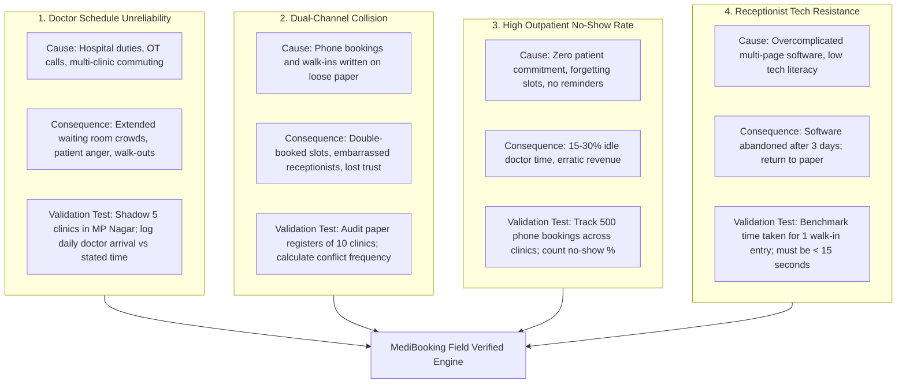
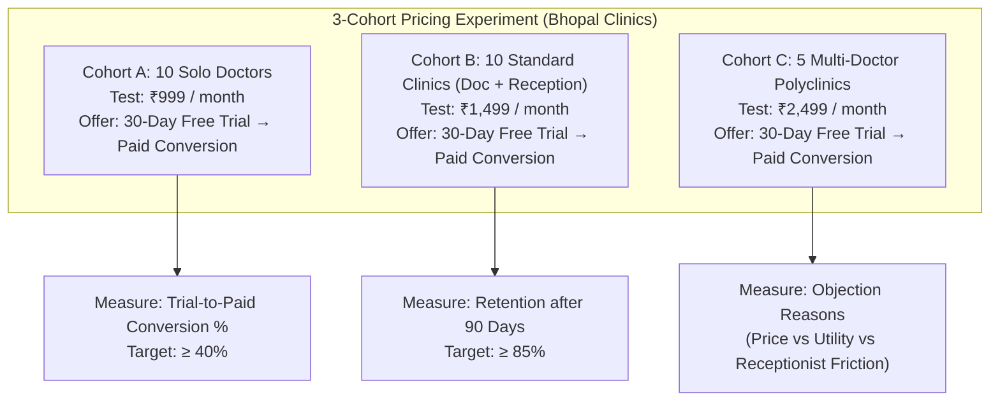
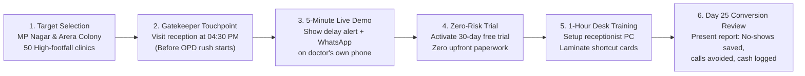
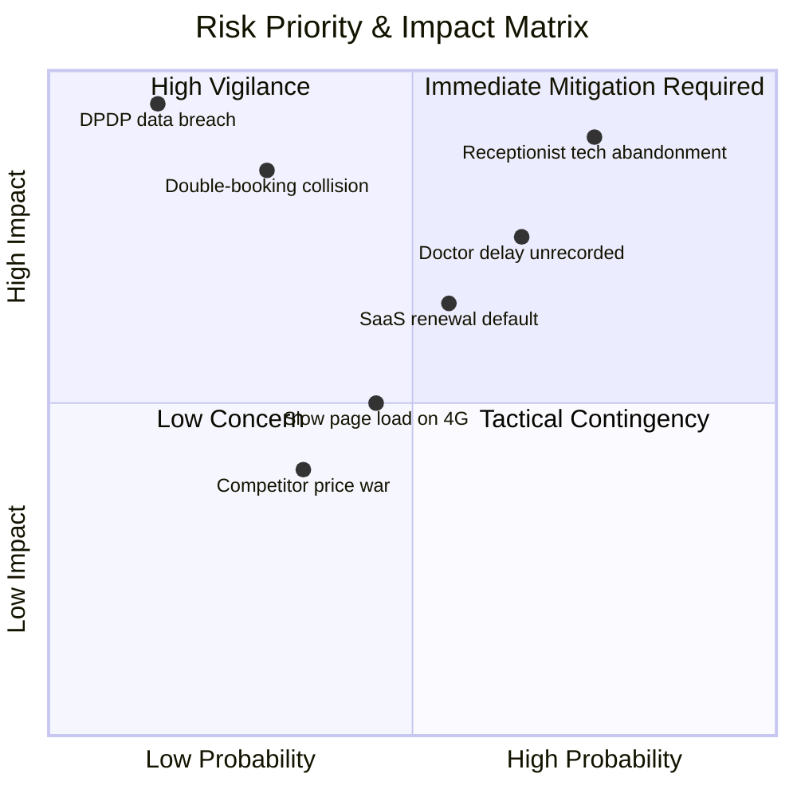
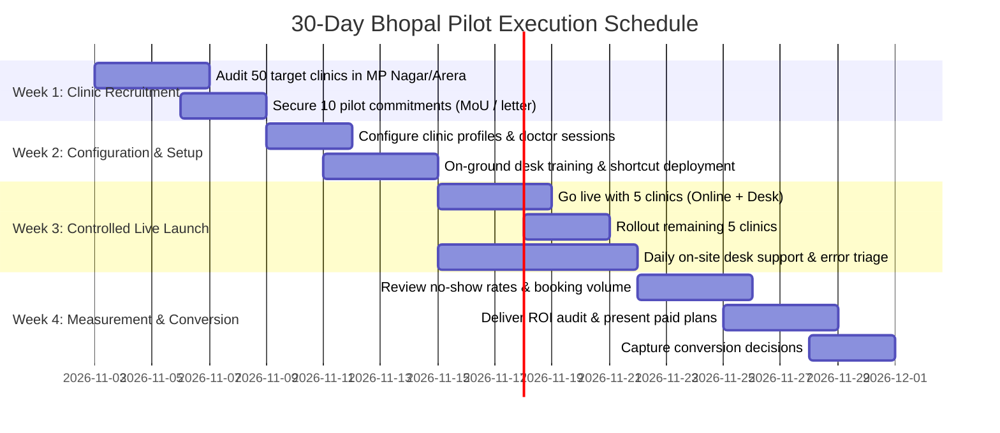
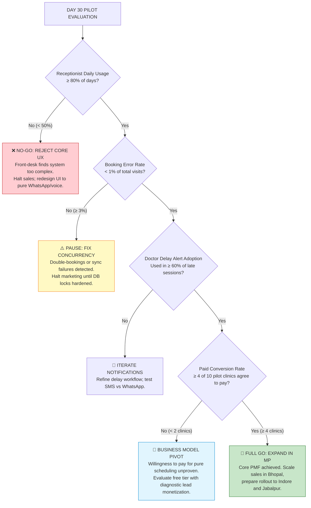

# MediBooking.in — MVP Backlog, Problem Validation & Field Pilot Framework

> **Document ID:** MB-SPEC-08  
> **Prepared by:** Product Manager, Indian Healthcare Market Research Analyst, SaaS Pricing Strategist  
> **Target Market:** Bhopal, Madhya Pradesh (Phase 1 Validation Hub)  
> **Version:** 1.0  
> **Status:** Operational Action Plan

---

## Deliverable A: Problem Validation Report

Before engineering code, every identified operational friction point must be tested against real-world clinical behavior in Bhopal.

### Detailed Validation Matrix

| Clinic Problem | Operational Cause | Measurable Impact | Validation Method & Metric | Threshold for Confirmation |
|:---|:---|:---|:---|:---|
| **Doctor Delays** | Unpredictable hospital duties (AIIMS/Hamidia/Bansal rounds) | 45+ min patient wait times; waiting room confrontation | Track 20 doctor arrival times across 10 working days | ≥ 40% of sessions start > 20 mins late |
| **Double-Booking Conflicts** | Phone calls taken while walk-ins are seated without real-time calendar syncing | 2-4 patient clashes per week per clinic | Receptionist interviews + incident log inspection | ≥ 70% of clinics report weekly booking clashes |
| **Patient No-Shows** | Patients book appointments across 2-3 clinics simultaneously as backups | Loss of ₹2,000–5,000 in daily doctor consultation potential | Retrospective review of 10 clinic paper registers | Baseline no-show rate ≥ 15% |
| **Receptionist Overload** | 50–100 repetitive phone calls asking "Is doctor sitting today?" and "What is token now?" | Receptionist spends > 60% of shift on phone, neglecting arriving patients | Shadowing front desks during evening peak (6–8 PM) | ≥ 40 calls/evening handled by receptionist |
| **SaaS Payment Resistance** | Doctors perceive software as an unneeded expense or fear percentage cuts | High churn after free trial | Willingness-to-pay testing with 20 clinic owners | ≥ 40% express willingness to pay ₹999–1,499/mo |

---

## Deliverable F: Structured MVP Backlog (P0 / P1 / P2)

### P0: Essential for Bhopal Pilot Launch (Sprint 1–3)

| ID | User Story | Acceptance Criteria | Complexity |
|:---|:---|:---|:---:|
| **P0-01** | As a **Doctor**, I want to set my recurring clinic sessions for specific days and hours, so that patients only book when I am present. | 1. Doctor can define start/end times and slot durations (10, 15, 20, 30m). 2. Slots automatically generate for next 14 days. 3. Different schedules permitted for different clinic affiliations. | Medium |
| **P0-02** | As a **Doctor**, I want to tap a button to delay my session by 15, 30, or 45 minutes, so that waiting patients are notified automatically. | 1. 1-tap delay shifts all unconsulted slots forward. 2. WhatsApp broadcast triggers to all booked patients for that session. 3. Receptionist board updates in real time without browser reload. | High |
| **P0-03** | As a **Patient**, I want to discover a Doctor profile (`/dr/:slug`) or search by specialty (Cardiology, Dermatology, Ortho), so I can book at my preferred clinic venue. | 1. Doctor-first public profile page highlighting qualifications & reviews. 2. Displays all consulting clinics and chambers. 3. Clean mobile web interface in Hindi and English with OTP verification. | Medium |
| **P0-04** | As a **Receptionist**, I want to add a walk-in patient in under 15 seconds and route them to a specific doctor chamber, so the queue is accurate without delaying front-desk flow. | 1. Modal requires only Name, Mobile, Age, and Doctor selection. 2. Keyboard shortcuts enabled (`F2` to trigger). 3. Scoped view: Clinic-Wide sees all chambers; Doctor-Dedicated sees assigned doctor only. | Low |
| **P0-05** | As a **System**, I must prevent concurrent bookings on the same slot across all channels, so that double-booking is impossible. | 1. Atomic Redis Lua script mutex locks slot in < 1.2ms. 2. PostgreSQL transaction with `SELECT FOR UPDATE` enforces single booking. 3. Exclude overlapping time constraints in database engine. | High |
| **P0-06** | As a **Patient**, I want an instant WhatsApp booking confirmation with clinic address and directions, so I have proof of appointment. | 1. WhatsApp template message dispatched within 5 seconds of booking. 2. Includes Doctor name, Token number, Slot time, and Google Maps link. 3. Fallback SMS sent if WhatsApp fails. | Medium |
| **P0-07** | As a **Receptionist**, I want to mark patient status (`Arrived`, `In-Consult`, `Completed`), so the doctor and clinic know the live queue state. | 1. 1-click status update buttons on the main dashboard. 2. Non-linear bypass: Doctor can call patient directly if check-in was skipped. 3. Status changes broadcast in real-time to Waiting Room TV via SSE. | Low |
| **P0-08** | As a **Clinic Admin / Staff**, I want to record cash or direct UPI payments collected at the desk, so daily collections are balanced. | 1. Front-desk can select Cash vs Direct UPI. 2. Generates simple digital receipt with serial receipt number. 3. Daily cash reconciliation summary exported at end of day. | Low |
| **P0-09** | As a **Clinic Admin**, I want to create my clinic profile and add multiple doctors with their specialties and chambers, so my polyclinic can be scheduled. | 1. Clinic creation with chamber/room configuration. 2. Add/invite doctors with specific consulting days, hours, and fees. 3. Multi-doctor roster reflected immediately on front-desk board. | Medium |
| **P0-10** | As any **User**, I want a single unified login page (`/login`) using phone OTP that automatically routes me to my designated portal. | 1. Single login endpoint for all 5 roles. 2. Evaluates role and active clinic context; redirects to `/super-admin`, `/admin`, `/doctor`, `/receptionist`, or `/patient`. 3. Tenant switcher modal for multi-clinic doctors. | Medium |

### P1: Fast-Follow Enhancements (Sprint 4–5)

| ID | User Story | Acceptance Criteria | Complexity |
|:---|:---|:---|:---:|
| **P1-01** | As a **Clinic**, I want an automated WhatsApp reminder sent 2 hours before the appointment with a 1-tap confirmation button, to reduce no-shows. | 1. Automated cron evaluates upcoming appointments. 2. Sends interactive WhatsApp message: "Reply 1 to Confirm, 2 to Cancel". 3. Reception dashboard updates badge to "Patient Confirmed" upon reply. | Medium |
| **P1-02** | As a **Receptionist**, I want a Standby Waitlist queue, so when a patient cancels, the next waiting patient is offered the slot. | 1. Waitlist capped at 5 patients per session. 2. Auto-sends claim invitation to Waitlist #1 upon cancellation. 3. 10-minute acceptance window before cascading to #2. | High |
| **P1-03** | As a **Doctor**, I want a lightweight mobile view of today's patient queue, so I can review visits from my phone. | 1. Responsive mobile dashboard for doctors. 2. Shows live queue, consulted count, and remaining patients. 3. Ability to mark consultation completed from inside the chamber. | Medium |
| **P1-04** | As a **Clinic Owner**, I want an automated GST invoice generated monthly for my MediBooking SaaS subscription, for business accounting. | 1. Monthly invoice PDF generated with clinic GSTIN and HSN code. 2. Auto-emailed and available for download in Clinic Admin portal. | Medium |

### P2: Advanced Capabilities for Later Expansion (Post-Validation)

| ID | Capability | Strategic Rationale for Postponement |
|:---|:---|:---|
| **P2-01** | Full Electronic Medical Records (EMR/EHR) | Small clinics resist typing long clinical notes during busy OPDs; paper prescriptions remain the norm. |
| **P2-02** | Telemedicine Video Consultations | Requires extensive regulatory compliance under Telemedicine Guidelines 2020; high legal and audio/video bandwidth overhead. |
| **P2-03** | ABDM / ABHA Health Information Exchange | High integration complexity with NHA sandbox; irrelevant to solving the immediate Bhopal scheduling pain. |
| **P2-04** | Diagnostic Lab & Pharmacy Commission Split | Premature commercial complexity; distracts from building a sticky core clinic scheduling OS. |

---

## Deliverable G: Business Model, Pricing Experiments & Clinic Acquisition

### 1. SaaS Pricing Validation Experiments

`[PREFERENCE]`: Subscription price points must be tested empirically in Bhopal rather than assumed:

### 2. Clinic Acquisition Playbook (Founder-Led Field Sales)

---

## Deliverable H: Comprehensive Risk Register

| Risk ID | Category | Risk Description | Probability | Impact | Mitigation Strategy | Owner |
|:---|:---|:---|:---:|:---:|:---|:---|
| **R-01** | Adoption | Receptionist abandons software and reverts to paper register | High | Critical | The 15-second entry rule; zero nested screens; physical desk training; dedicated founder WhatsApp support line. | Product |
| **R-02** | Operational | Doctor does not communicate hospital delays to clinic desk | High | High | Doctor mobile 1-tap delay link sent via WhatsApp 30 mins before session start: "Are you on time today?". | Operations |
| **R-03** | Technical | Network timeout during booking causes duplicate or failed slot allocation | Medium | High | Mandatory `X-Idempotency-Key` headers on all booking APIs; Redis distributed mutex locks with atomic rollback. | Engineering |
| **R-04** | Privacy | Patient health data or diagnosis inadvertently leaked to receptionist | Low | Critical | Strict RBAC; clinical symptoms masked from receptionist dashboard; separate database vaults for clinical data. | Security |
| **R-05** | Financial | Clinic refuses to convert to paid plan after 30-day free trial | Medium | High | Present automated ROI scorecard on Day 25 demonstrating reduced no-shows and quantified administrative hours saved. | Sales |
| **R-06** | Regulatory | Non-compliance with DPDP Rules 2025 regarding consent and breach notices | Low | Critical | Bilingual privacy notices at collection; explicit opt-in checkboxes; documented 72-hour breach response runbook. | Legal |

---

## Deliverable I: 30-Day Pilot Execution Plan (Bhopal Hub)

### Week-by-Week Deployment Timeline

### Pilot Clinic Selection Scorecard (10 Clinics)

To ensure the pilot produces statistically meaningful and operationally diverse data:
- **4 General Physician / Internal Medicine Practices** (High daily volume: 30–50 patients, heavy walk-in traffic).
- **3 Orthopedic / Pediatric Specialists** (Appointment-centric: 20–30 patients, high caregiver booking ratio).
- **2 Polyclinics / Multi-Doctor Facilities** (Complex multi-calendar reception dynamics).
- **1 Obstetrics & Gynecology Clinic** (Frequent emergency hospital calls, testing delay propagation).

---

## Deliverable J: Phased Implementation Roadmap

```mermaid
flowchart LR
    subgraph Stage1["STAGE 1: Core Scheduling Engine (Month 1-2)"]
        S1A["Multi-tenant database schema & RLS"]
        S1B["Doctor session & slot generation engine"]
        S1C["Atomic concurrency locking (Redis + PG)"]
        S1D["15-second receptionist walk-in & queue desk"]
    end

    subgraph Stage2["STAGE 2: WhatsApp & Patient PWA (Month 2-3)"]
        S2A["Zero-install mobile web booking PWA"]
        S2B["WhatsApp transactional confirmation & delay alerts"]
        S2C["Caregiver booking workflow"]
        S2D["Manual cash & UPI desk ledger"]
    end

    subgraph Stage3["STAGE 3: Monetization & Expansion (Month 3-4)"]
        S3A["SaaS subscription billing & UPI Autopay"]
        S3B["Automated GST B2B invoice generation"]
        S3C["End-of-day reconciliation & clinic analytics"]
        S3D["Launch pilot in Indore & Jabalpur"]
    end

    Stage1 --> Stage2 --> Stage3
```

---

## Phase 1 Go/No-Go Decision Framework (Calibrated Thresholds)

At the conclusion of the 30-day pilot across the 10 Bhopal clinics, the multidisciplinary strategy team will evaluate the product against strict, quantified criteria:

### Strategic Exit Criteria

| Signal Type | Metric / Evidence Observed | Strategic Action |
|:---|:---|:---|
| **Definitive GO** | ≥ 4 clinics convert to paid ₹999–1,499/mo; receptionist usage > 80%; no-show rates reduced by ≥ 25%. | Expand sales team in Bhopal; initiate architecture preparation for Indore rollout. |
| **Workflow Pivot** | Clinics love scheduling but receptionists refuse to open desktop browser. | Pivot front-desk interface to a dedicated WhatsApp Business chatbot for the receptionist. |
| **Pricing Pivot** | Clinics utilize the system daily but adamantly refuse subscription fees > ₹500/mo. | Lower base subscription to ₹499/mo and introduce value-added SMS/WhatsApp broadcast usage tiers. |
| **Definitive NO-GO** | < 2 clinics convert; doctors refuse to communicate delays; paper registers remain faster than software. | Terminate project before incurring major engineering or marketing capital expenditure. |

---

*End of Specification Set. All 10 deliverables (A through J) and operational problem analyses are fully articulated across MB-SPEC-06, MB-SPEC-07, and MB-SPEC-08.*

