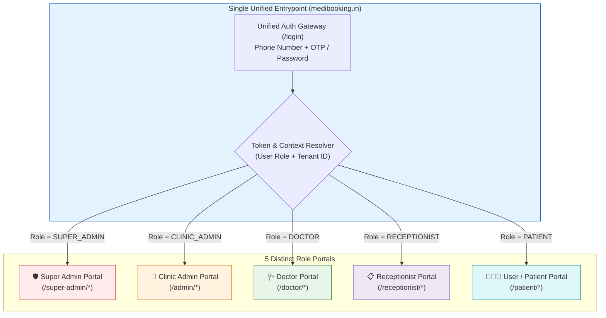
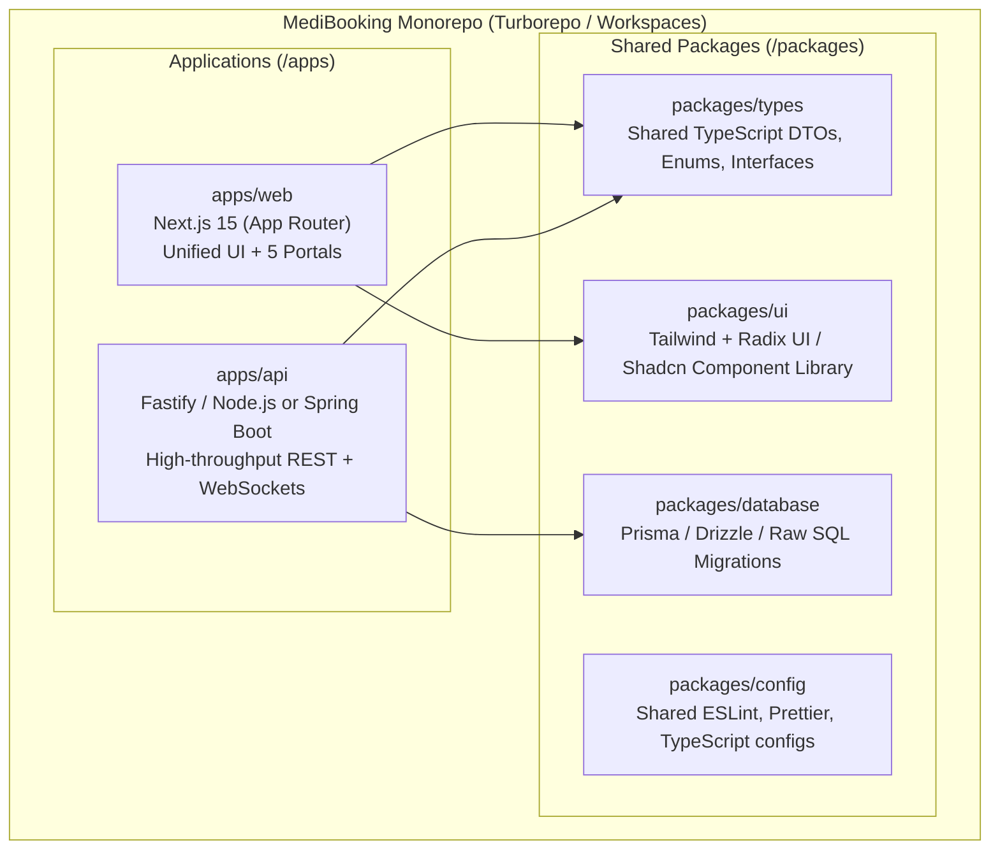
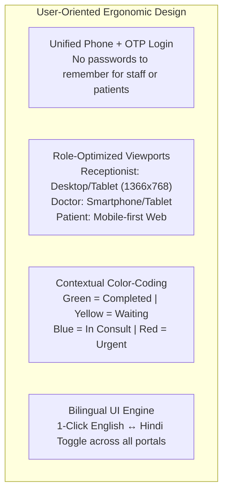
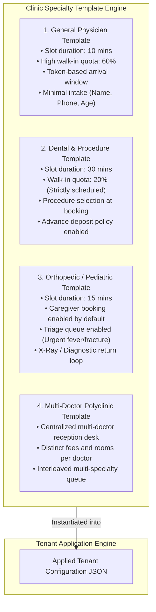

# MediBooking.in — Multi-Agent Strategic Review: Unified 5-Role Portals, Template Architecture & Monorepo Planning

> **Document ID:** MB-SPEC-09  
> **Review Date:** 2 November 2026  
> **Strategic Focus:** Unified Entrypoint UI, 5-Role Portals, Multi-Tenant Template Architecture & Monorepo Design  
> **Status:** Pending Architecture Confirmation from Founder

---

## Executive Summary & System Philosophy

MediBooking.in transitions from fragmented role-specific applications into a **Unified Single-Application Ecosystem (Monorepo)**. 

### The Core Architectural Principles:
1. **Doctor-First Discovery, Clinic-First Operations:**
   - **Doctor as Primary Brand & Anchor:** In India, patients seek the *Doctor* (their trust, credentials, and reputation), not the clinic building. MediBooking highlights the **Doctor Profile (`medibooking.in/dr/doctor-slug`)** as the primary public landing page, displaying doctor credentials, photo, reviews, and all clinics where they consult.
   - **Clinic as Operational Venue:** A clinic is the physical healthcare hub where one or more doctors consult. A doctor may practice across multiple clinics; a clinic hosts multiple doctors.
2. **Single Unified Entrypoint UI:** A single domain (`medibooking.in`) and a unified login interface (`/login`). The user logs in once via Phone OTP or credentials; the system evaluates their identity, tenant membership, and role, and seamlessly redirects them to their designated portal.
3. **Clinic Admin Provisions Clinics & Doctors:**
   - The **Clinic Admin** creates the clinic entity, defines rooms/chambers, and adds/invites multiple doctors (`[+ Add Doctor]`).
   - Admin configures each doctor's local clinic schedule, chamber number, consultation fees, and quota ratios.
4. **Clinic-Centric Team Workspace (Doctors + Receptionists Together):** 
   - Inside the clinic, a centralized **receptionist desk** serves all affiliated doctors.
   - Receptionists handle front-desk check-in, walk-ins, phone bookings, and payment collection, routing patients directly into the respective doctor's active chamber queue.
5. **Five Distinct Role Portals:**
   - **Portal 1: Super Admin Portal** (`/super-admin/*`) — Platform governance, doctor credential verification, global clinic approvals, SaaS subscription billing, system health.
   - **Portal 2: Clinic Admin Portal** (`/admin/*`) — Clinic profile creation, adding & affiliating doctors, receptionist staff provisioning, consultation fee setup, revenue reports.
   - **Portal 3: Doctor Chamber Portal** (`/doctor/*`) — Doctor's personal workspace, multi-clinic schedule glance, active chamber queue, 1-tap delay broadcast, prescription completion handshake.
   - **Portal 4: Receptionist Central Desk** (`/receptionist/*`) — Central front-desk OS for the entire clinic, multi-doctor tabbed queue board, 15-second fast walk-in intake routed to any doctor, cash/UPI desk ledger.
   - **Portal 5: User / Patient Portal** (`/patient/*` or `/app/*`) — Doctor-first discovery (`/dr/name`), selecting preferred clinic venue, real-time verified slot booking, caregiver booking, live token arrival tracker.
6. **Template-Based Clinic Operations:** Pre-configured operational bundles (General Physician, Dental, Orthopedic, Pediatric, Multi-Doctor Polyclinic) that define slot durations, triage rules, intake fields, and walk-in ratios out of the box.
7. **Clean Monorepo Architecture:** A single Git repository housing all frontend applications, backend services, and shared libraries (types, database schemas, UI kit) for rapid iteration, unified typing, and consistent deployment.



---

## 1. Multi-Agent Cross-Domain Review

We conducted a deep review of this 5-role, single-UI, template-driven monorepo model across five specialized perspectives:

---

### Agent 1: Business-Oriented Review

**Core Focus:** *Customer Acquisition Cost (CAC), Lifetime Value (LTV), Monorepo Operational Efficiency, Monetization of Templates.*

#### Findings & Strategic Adjustments:
1. **Single Domain Boosts SEO & Brand Equity:** Having one unified web application (`medibooking.in`) rather than separate apps (e.g. `doctor.medibooking.in`, `reception.medibooking.in`) concentrates all domain authority, backlinks, and organic patient search rankings onto one root domain.
2. **Template-Driven Onboarding Collapses CAC:** 
   - *Problem:* Small clinics in Bhopal abandon software if setup takes > 1 hour.
   - *Solution:* During onboarding, the Clinic Admin selects **"General Physician Template"** or **"Dental Clinic Template"**. The system instantly pre-configures slot timings (e.g., 10 mins vs 30 mins), queue rules, and receptionist permissions in **under 2 minutes**.
   - *Impact:* Slashes founder/onboarding agent field time from 3 hours per clinic to 20 minutes, cutting CAC from ₹3,000 to under ₹1,200.
3. **Multi-Role Seat Licensing:**
   - Base plan covers 1 Doctor + 1 Receptionist.
   - Additional Doctor seats: ₹500/month.
   - Additional Receptionist / Desk seats: ₹250/month.
   - Enables clear expansion revenue (Net Revenue Retention > 115%) as clinics grow into polyclinics.

---

### Agent 2: Technical-Oriented Review

**Core Focus:** *Monorepo Structure, Route Guards, State Machine, Tenant Context Resolution, Type Safety.*



#### Findings & Technical Adjustments:
1. **Unified Next.js App Router Structure:**
   - Single Next.js instance running on App Router.
   - Route layout isolation using route groups:
     - `app/(auth)/login/page.tsx` — Unified Login Screen
     - `app/(super-admin)/super-admin/*` — Super Admin Portal
     - `app/(clinic-admin)/admin/*` — Clinic Administrator Portal
     - `app/(doctor)/doctor/*` — Doctor Workspace
     - `app/(reception)/receptionist/*` — Front-Desk OS
     - `app/(patient)/patient/*` — Patient Booking & History
2. **Zero-Trust Middleware & Dynamic Routing:**
   - A single Next.js `middleware.ts` intercepts all requests.
   - Verifies session token (JWT / Iron Session).
   - If user visits `/admin` but has role `RECEPTIONIST`, middleware forces redirect to `/receptionist`.
   - If user is multi-tenant (e.g., a doctor working at 2 different clinics), a **Clinic Switcher** modal intercepts the session to establish active `clinic_id` before entering the portal.
3. **Shared Type Safety:**
   - Complete contract parity between backend and frontend. If an appointment status changes in `packages/types`, the entire monorepo verifies compilation integrity across all 5 portals simultaneously.

---

### Agent 3: Realtime Platform Handling Review

**Core Focus:** *Real-Time Queue Sync, Doctor Delay Propagation, Socket Overhead, Offline Grace.*

#### Findings & Realtime Adjustments:
1. **Unified WebSocket / Server-Sent Events (SSE) Bus:**
   - Real-time updates are critical between **Receptionist**, **Doctor**, and **Patient**.
   - *Architecture:* Redis Pub/Sub channels partitioned by tenant: `channel:clinic:{clinic_id}:queue`.
   - When receptionist marks Token #4 as `IN_CONSULTATION`:
     - Receptionist screen updates instantly.
     - Doctor screen highlights Token #4 as active patient.
     - Waiting Room TV updates the token display.
     - Patient #5 on mobile web sees: *"You are next in line. Please proceed to the clinic door."*
2. **Low-Bandwidth Optimization for Tier-2 Networks:**
   - Tier-2 networks in Bhopal (e.g., inside basements or crowded markets) fluctuate between 4G and 3G.
   - Sockets must implement aggressive heartbeat (30s ping/pong), exponential backoff reconnection, and graceful fallback to HTTP long-polling.

---

### Agent 4: User-Oriented & Front-Desk UX Review

**Core Focus:** *Authentication Ergonomics, Zero Password Fatigue, Mobile Responsiveness, Keyboard Shortcuts.*



#### Findings & UX Adjustments:
1. **The Password Problem:** Clinic staff frequently forget complex passwords, leading to locked accounts during busy OPD hours.
   - *Fix:* **Phone OTP as Primary Login**. Receptionists and doctors log in via 6-digit WhatsApp or SMS OTP. Passwords remain an optional secondary setting.
2. **Patient Zero-Friction:** A patient booking via a clinic QR code does **not** need to create an account prior to viewing availability. They pick a slot, enter their phone number + OTP at checkout, and the system automatically logs them into the Patient Portal.
3. **Doctor Chambers Ergonomics:** Doctors in Bhopal rarely want to type extensive data. The Doctor Portal must be a **1-Hand Mobile Web Glance**:
   - Tap to see who is waiting.
   - Tap to mark "Call In".
   - Tap to mark "Done".
   - Tap to alert "Delay 30 mins".

---

### Agent 5: Medical Services & Clinical Governance Review

**Core Focus:** *Clinical Safety, Duty Separation, DPDP 2023 Compliance, Prescription Handshake.*

#### Findings & Governance Adjustments:
1. **Strict Information Firewall (Receptionist vs Doctor):**
   - In small clinics, receptionists are often neighborhood residents. Patients feel anxious if reception staff can view their clinical complaints (e.g., gynecology, dermatology, psychiatric issues).
   - *Rule:* The Receptionist Portal displays **only** Administrative Data (Token #, Name, Arrival Time, Billing Status). It **never** displays Clinical Reason, Symptoms, or Prescriptions.
2. **Prescription Status Handshake:**
   - To prevent patients leaving without settling consultation charges or missing medication instructions:
     - Doctor marks consultation finished -> creates or issues Rx -> clicks `Issue Prescription`.
     - System updates administrative flag: `prescription_issued = true`.
     - Receptionist dashboard updates with a green badge: `Ready for Checkout`.
     - Receptionist collects payment, prints receipt, and hands over documentation.
3. **Medical Emergency Safeguard:**
   - Neither the software nor any AI assistant may perform automated medical triage.
   - If a walk-in patient presents severe symptoms, the receptionist uses a prominent red button: **[🚨 Flag Urgent / Triage]**. This immediately bumps the token to the top of the queue for the doctor's immediate review, without claiming to make clinical decisions.

---

## 2. Detailed 5-Role Portal Functional Breakdown

```mermaid
classDiagram
    class SuperAdminPortal {
        +Tenant Onboarding & Approval
        +Doctor Registration & Verification
        +Global Platform Health & Metrics
        +SaaS Subscription & Billing Engine
        +Security & Audit Log Explorer
    }

    class ClinicAdminPortal {
        +Clinic Profile & Branding Setup
        +Template Selection (GP, Dental, Ortho)
        +Doctor-Clinic Affiliation Management
        +Staff & Receptionist Account Provisioning
        +Consultation Pricing & Fee Rules
        +Financial Analytics & Daily Revenue
    }

    class DoctorPortal {
        +Live Session Glance & OPD Tracker
        +1-Click Delay & Leave Broadcaster
        +Call-In Next Patient
        +Consultation Finish & Rx Handshake
        +Personal Schedule & Hours Override
    }

    class ReceptionistPortal {
        +15-Second Fast Walk-In Intake (F2)
        +Phone Booking Rapid Search & Entry
        +Live Queue Board (Arrived, Waiting, In-Consult)
        +Cash & Direct UPI Ledger Reconciliation
        +Standby Waitlist Management
    }

    class PatientPortal {
        +Doctor & Clinic Profile Discovery
        +Real-Time Verified Slot Booking
        +Caregiver Booking (Family Members)
        +Live Token & Queue Position Tracker
        +Visit History & Digital Receipts
    }
```



### Portal 1: Super Admin Portal (`/super-admin/*`)
- **Users:** MediBooking Executive & Operations Team.
- **Capabilities:**
  1. *Clinic Management:* View, verify, approve, or suspend clinics.
  2. *Doctor Credential Desk:* Verify State Medical Council numbers against official registries.
  3. *Subscription Central:* Track paying clinics, MRR, churn, grace periods, and failed UPI Autopay mandates.
  4. *Platform Telemetry:* Real-time server load, Redis lock contention, notification delivery rates (WhatsApp/SMS).
  5. *Compliance Audit:* Access logs for security audits per DPDP Act 2023.

### Portal 2: Clinic Admin Portal (`/admin/*`)
- **Users:** Clinic Owner, Senior Medical Director, or Practice Manager.
- **Capabilities:**
  1. *Clinic Operational Settings:* Address, geo-location, phone numbers, operating hours.
  2. *Template Switcher:* Switch or customize clinic operational templates (GP vs Dental vs Polyclinic).
  3. *Doctor Roster Management:* Add doctors, assign consultation fees, define split quotas (online vs walk-in).
  4. *Staff Accounts:* Provision receptionist accounts with granular access limits.
  5. *Financial Analytics:* Total daily footfall, revenue breakdown (Cash vs UPI), no-show percentages, peak hours.

### Portal 3: Doctor Portal (`/doctor/*`)
- **Users:** Consulting Physicians and Specialists.
- **Capabilities:**
  1. *OPD Session Control:* Start session, pause session, end session.
  2. *1-Tap Delay Alert:* Shift downstream slots by 15/30/45 minutes with automated patient notification.
  3. *Chamber Queue:* View waiting list, call next patient, view patient demographic summary.
  4. *Clinical Handshake:* Signal prescription completion to front desk.
  5. *Schedule Builder:* Request leave, block specific calendar dates, adjust personal consultation fees.

### Portal 4: Receptionist Portal (`/receptionist/*`)
- **Users:** Clinic-Wide Front-Desk Staff OR Doctor-Dedicated Assistants / Compounders.
- **Dual-Scope Operation:**
  - *Scope A (`CLINIC_WIDE`):* Sits at central entrance. Manages multi-doctor tabbed dashboard across all chambers (Cardiology, Dermatology, Orthopedics, Pediatrics), general intake, phone routing, and centralized cashiering.
  - *Scope B (`DOCTOR_DEDICATED`):* Sits outside a specific doctor's chamber. Bound strictly to that assigned physician; manages that chamber's queue, patient check-in, and examination preparation.
- **Capabilities:**
  1. *Live Queue Controller:* High-contrast dashboard with status cards (`Arrived`, `Waiting`, `In-Room`, `Completed`).
  2. *Fast Walk-In Entry (`F2`):* 15-second registration modal with immediate doctor/chamber routing.
  3. *Phone Booking Desk:* Rapid multi-specialty doctor and slot search during incoming calls.
  4. *Desk Payment Logger:* Record Cash or Direct UPI transactions with sequential receipt numbering.
  5. *Waitlist Cascader:* Offer canceled slots to standby patients.

### Portal 5: User / Patient Portal (`/patient/*`)
- **Users:** Patients, Family Caregivers, and General Public.
- **Capabilities:**
  1. *Slot Booking Engine:* View real-time availability; book with zero app installation.
  2. *Caregiver Mode:* Book and manage appointments for children, spouses, or elderly parents under one mobile number.
  3. *Live Token Tracker:* View estimated arrival time and live chamber status before leaving home.
  4. *Self-Service Rescheduling:* Reschedule or cancel appointments within clinic-defined policies.
  5. *Receipts & Confirmations:* Download official clinic booking slips and payment receipts.

---

## 3. The Clinic Template Architecture

Rather than forcing every clinic into an inflexible configuration or building an overly complex custom workflow builder, MediBooking uses **Pre-Packaged Operational Templates**:



### Template Configuration Schema Example
```json
{
  "template_id": "tpl_general_physician_v1",
  "template_name": "General Physician High-Volume",
  "scheduling_mode": "TOKEN_ESTIMATED_WINDOW",
  "default_slot_minutes": 10,
  "quota_distribution": {
    "online_percentage": 40,
    "walkin_percentage": 50,
    "emergency_buffer_percentage": 10
  },
  "intake_fields": {
    "collect_age": true,
    "collect_gender": true,
    "collect_locality": true,
    "collect_blood_group": false
  },
  "queue_rules": {
    "allow_urgent_triage_override": true,
    "grace_period_no_show_minutes": 15,
    "auto_cascade_waitlist": true
  },
  "payment_rules": {
    "default_mode": "PAY_AT_CLINIC",
    "allow_cash": true,
    "allow_direct_upi_qr": true
  }
}
```

---

## 4. Monorepo Architecture Blueprint

### Directory Structure
```
medibooking/
├── .github/                  # CI/CD Workflows (Lint, Test, Build, Deploy)
├── apps/
│   ├── web/                  # Next.js 15 (Unified App Router: 5 Portals + Landing)
│   │   ├── app/
│   │   │   ├── (auth)/       # /login, /verify-otp
│   │   │   ├── (public)/     # Landing page, /clinic/[slug], /doctor/[slug]
│   │   │   ├── super-admin/  # Portal 1: Super Admin dashboard & routes
│   │   │   ├── admin/        # Portal 2: Clinic Admin dashboard & routes
│   │   │   ├── doctor/       # Portal 3: Doctor glance & OPD chamber
│   │   │   ├── receptionist/ # Portal 4: Front-Desk OS & Queue board
│   │   │   └── patient/      # Portal 5: Patient dashboard & token tracker
│   │   ├── middleware.ts     # Role-based auth interceptor & tenant guard
│   │   └── package.json
│   │
│   └── api/                  # Core Backend Engine (Node.js/Fastify or Spring Boot)
│       ├── src/
│       │   ├── modules/
│       │   │   ├── auth/
│       │   │   ├── scheduling/
│       │   │   ├── appointments/
│       │   │   ├── queue/
│       │   │   ├── payments/
│       │   │   └── notifications/
│       │   └── server.ts
│       └── package.json
│
├── packages/
│   ├── types/                # Shared TypeScript contracts (DTOs, Roles, Enums)
│   ├── database/             # PostgreSQL DDL, Migrations, RLS scripts
│   ├── ui/                   # Shared Tailwind + Radix UI component system
│   ├── config/               # Shared ESLint, Prettier, TS configs
│   └── logger/               # Structured JSON logger with DPDP masking
│
├── turbo.json                # Turborepo task pipeline configuration
├── package.json              # Monorepo root package.json (pnpm / npm workspaces)
└── README.md
```

---

## 5. Summary of Document Corrections Completed

1. **`06-CLINIC-WORKFLOW-AND-FEATURES-SPEC.md`:**
   - Updated role definitions to explicitly distinguish **Clinic Admin (Owner)** from **Doctor** and **Receptionist**.
   - Added template-driven configuration schemas (GP, Dental, Pediatric, Polyclinic).
   - Documented the unified phone + OTP single-login flow with automatic redirection.

2. **`07-SYSTEM-ARCHITECTURE-AND-TECH-SPEC.md`:**
   - Aligned database schemas (`users.role`) to strictly support the 5 roles: `SUPER_ADMIN`, `CLINIC_ADMIN`, `DOCTOR`, `RECEPTIONIST`, `PATIENT`.
   - Updated Route-Level Security and API authorization matrices for each portal path.
   - Formatted for monorepo package sharing (`packages/types`, `packages/database`).

3. **`08-MVP-BACKLOG-AND-PILOT-FRAMEWORK.md`:**
   - Structured backlog user stories cleanly across the 5 portals.
   - Incorporated the unified entrypoint login acceptance tests into Sprint 1.

---

## 6. Architecture Design Confirmation Request

All specifications, real-world clinic workflows, multi-agent reviews, and structural plans are now fully aligned with your vision:
- **5 Roles & Portals**
- **Single UI with Intelligent Role-Based Redirects**
- **Multi-Tenant & Template-Based Configuration**
- **High-Performance Clean Monorepo Structure**

> ⚠️ **Waiting for Confirmation:**  
> Please confirm if you approve this refined direction. Once confirmed, we will proceed immediately to the **Detailed Architecture Implementation Plan** (complete frontend routing spec, backend service modules, state machine diagrams, and monorepo setup commands).

