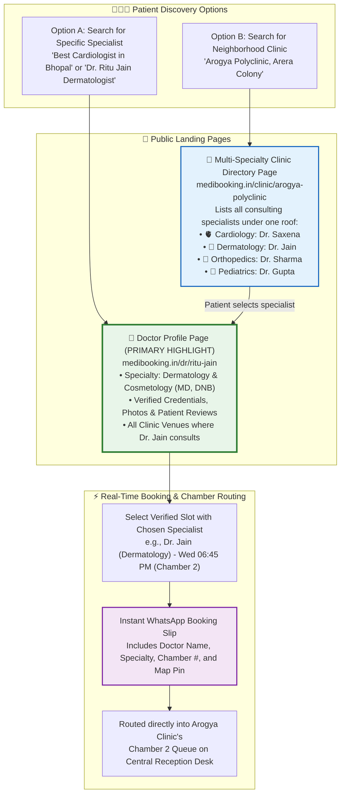
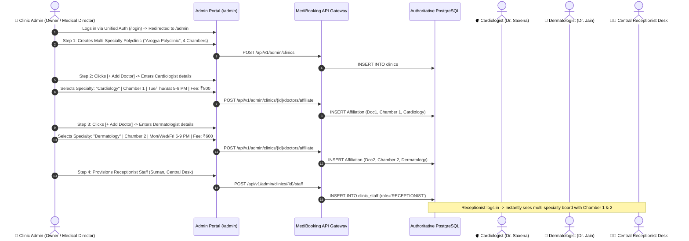
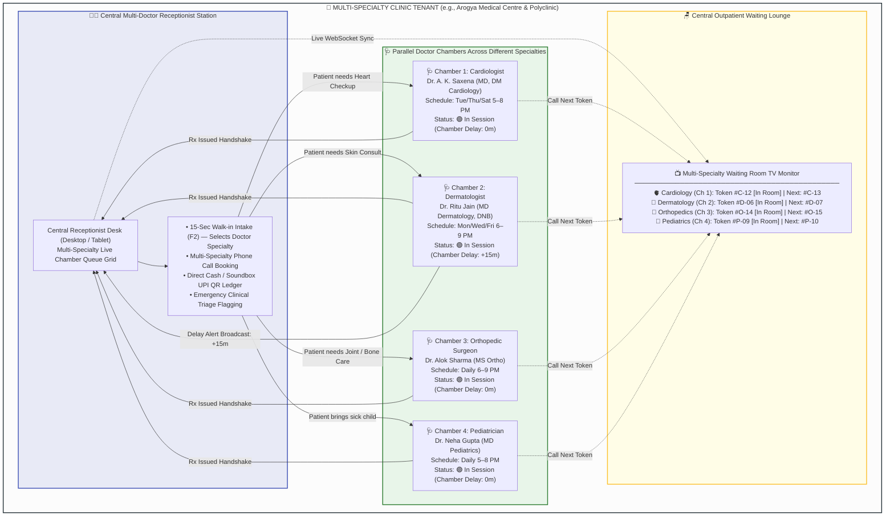
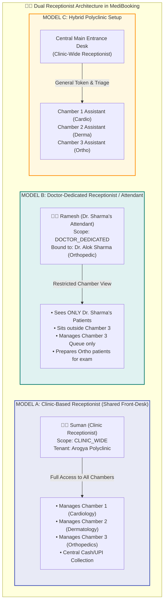
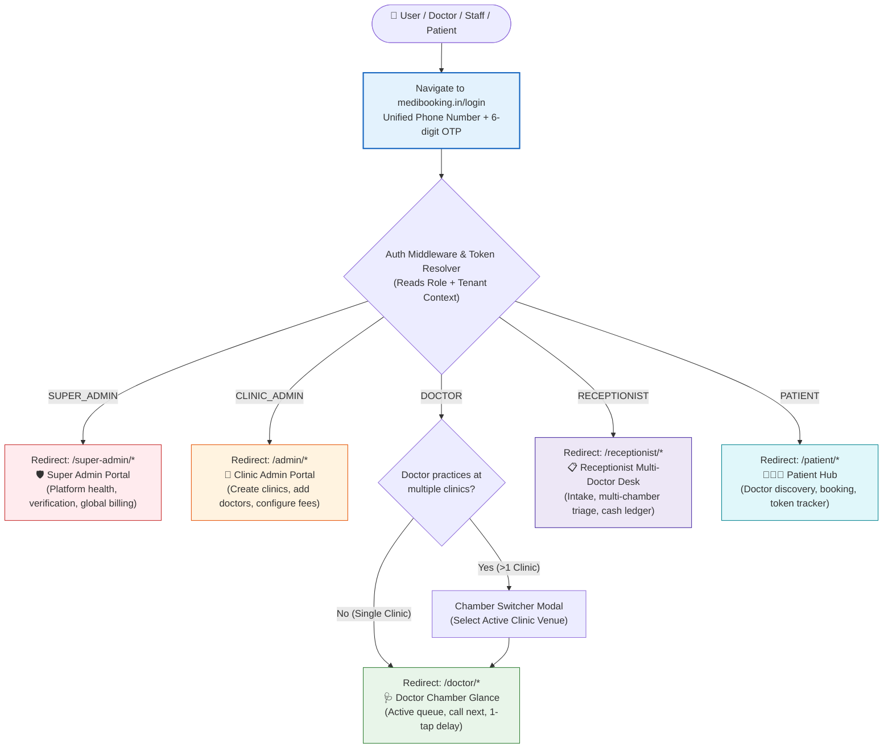
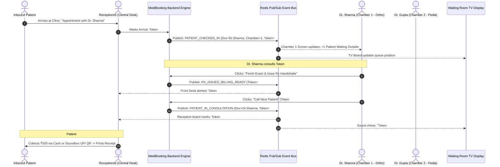
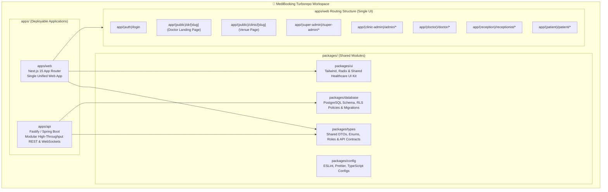

# MediBooking.in — Visual Architecture Blueprint (Doctor-First & Multi-Doctor Team)

> **Document ID:** MB-SPEC-10  
> **Updated:** 2 November 2026  
> **Key Architecture Directives:**  
> 1. **Doctor-First Discovery:** Doctors are the primary highlight for patients; clinics are the consulting venues.  
> 2. **Admin Clinic & Doctor Provisioning:** Clinic Admin creates the clinic entity and adds/invites multiple doctors.  
> 3. **Clinic Team Collaboration:** Receptionists and multiple Doctors operate together inside a single clinic tenant.  
> 4. **Single-UI Unified Login:** One login interface with automatic role-based portal routing.  
> 5. **Monorepo Structure:** Clean Turborepo / npm workspaces architecture.

---

## 1. Doctor-First Patient Discovery & Multi-Specialty Clinic Booking

---

## 2. Clinic Admin Multi-Specialty Provisioning Flow (Create Clinic & Add Specialists)

---

## 3. Multi-Specialty Clinic Team Workspace (Receptionist + Specialists Together)

---

### 3.1 Dual-Scope Receptionist Operating Model (Clinic-Based vs Doctor-Dedicated)

---

## 4. Single-UI Unified Entrypoint & 5-Role Redirection

---

## 5. End-to-End Realtime Chamber & Queue Coordination

---

## 6. Monorepo Codebase & Dependency Graph

---

*This visual architecture blueprint is archived in `docs/10-VISUAL-ARCHITECTURE-DIAGRAMS.md`.*
